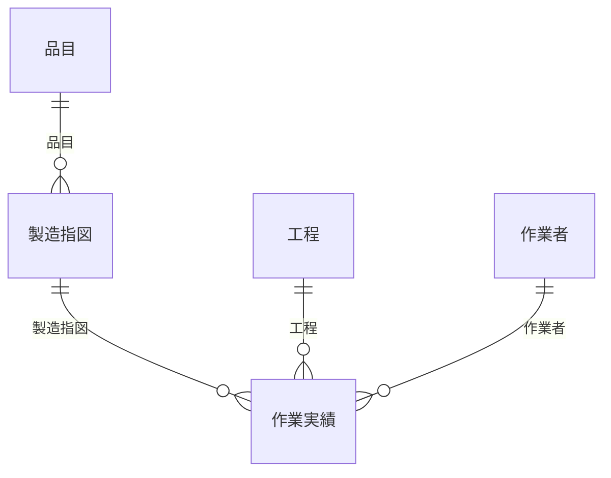

## TL;DR

**小規模な業務システムでも、柔軟な検索条件への対応や継続的な要件変更が求められるなら、Amplify Gen 2でRDBを使う構成を選びたい。**

- **単なる試作や、アクセスパターンが単純で安定している用途にはAmplify Data＋DynamoDB。**
- **業務を理解しながら検索条件やデータの関係を変更していく用途にはRDB。**
- **今回の構成では、検索・データ保持の両方でRDB案の方が安かった。**

## 1. 背景と問題意識

### これまでのキャリア

私は中小企業のDXや社内業務システムの開発に携わってきました。業務に合わせてスクラッチ開発することが多く、利用者は数十人、データは数千～万件程度です。

社内業務での利用を想定しているため、24時間365日の連続利用を前提とした高可用性は不要です。導入後も継続して利用できる運用費用が重要になります。

### 小規模でも事業ドメインは複雑という課題感

製造業などでは専門性の高い業務ドメインを扱います。利用者数やデータ件数が少なくても、データ間の関係は複雑になり得ます。顧客から柔軟な検索を求められる場面も多くあります。

ミニマムで開発してみても、テストが進むにつれて要望が浮かんでき、モデルやデータ間の関係にも変更が生じます。例えば、別管理していたケースがあり、システムで一元管理したい、名前や数で検索したい、という追加要望が出てきます。これらは自然だと思います。

もちろん、業務を整理し、シンプルにする努力はITベンダーの責務という前提です。必要性を検討し、整理・削減できるものや運用で対処すべきものと、業務に必要なものを見極める努力はします。

ただ、技術の都合で顧客に既定のモデルへの適合を求めすぎると、個別に開発する意義が薄れるため行いたくはありません。顧客の業務に合わせて提供できることを、受託開発の価値として捉えています。

本ケースでは大規模な利用に備えることより、複雑な関係や変更を扱うことが重要になります。アクセスパターンが開発中に変わることがDB選定の前提になります。

### RDBを検討したきっかけ

これまで、コスト要件に応じてサーバーレスアーキテクチャを採用し、Amplify Gen2というWebアプリケーションフレームワークを使用してきました。Amplifyは、DBとしてDynamoDBを使用しています。

開発する中で、柔軟な検索やモデルの変更が続く業務アプリでは、DynamoDBのキー・インデックス設計や取得処理の変更が負担になり、RDBの方が扱いやすいのではないかと感じていました。

その中で、処理量に応じた従量課金のAurora DSQLと、Amplify Gen 2と一緒にRDBを定義・デプロイできるAWS Blocksが登場しました。RDBの常時稼働費用や構築の負担を抑えて使えそうだと考えました。

そこで、Amplify Data＋DynamoDBとDrizzle＋Blocks＋Aurora DSQLで同じ業務アプリを作り、通常利用と要件変更への対応、費用を比較しました。

### 今回比較する構成

Webアプリの共通基盤としてAmplify Gen 2を使い、業務データの保存・検索・変更を扱う構成を比較します。DynamoDB案はAmplify Data＋DynamoDB、RDB案はDrizzle＋AWS Blocks＋Aurora DSQLで実装します。

同じ業務要件に対して、通常の登録・検索・表示と、検索条件やデータの関係を変更する際の対応を確認します。

### 比較の目的と観点

顧客の予算内で、業務に必要な機能・可用性を提供し続けられるかを確かめます。
評価軸には[AWS Well-Architected Framework](https://docs.aws.amazon.com/wellarchitected/latest/framework/the-pillars-of-the-framework.html)の6つの柱のうち、今回の検証対象に対応する次の3つを用います。

- パフォーマンス効率
    - 必要なデータを得るまでの要求数・取得量・応答時間
- コスト最適化
    - DBの読み取り・処理量、保存量・保持料金、API・Lambdaの費用
    - マスター初回取得の費用
- 運用上の優秀性
    - 通常利用の実装：モデルの定義、登録・検索・表示の書き方と型
    - 要件変更への対応：検索条件・モデルの変更に伴う修正範囲と保守の負担
    - 変更の適用：既存データの移行・デプロイの手順

## 2. 検証用アプリと比較条件

検証には製造指図・作業実績を管理する業務アプリを使います。両案の業務要件を各段階で揃え、DBとバックエンドの実現方法を変えて比較します。

顧客から追加要望を受けたと想定し、初期要件から追加要件1・2へ順に反映します。各段階で、追加した機能を含む通常利用と変更対応を比較します。

### 完成形の画面イメージ

製造指図一覧では品目名・作業者名で検索し、該当する指図を表示します。


製造指図詳細では指図の内容と、複数の参加者・各自の作業時間を含む作業実績を表示します。


### 要件

アプリを触る中で要件が追加になるケースを想定しています。

- 初期要件
    - 製造指図の登録・一覧・詳細と品目名検索。作業実績は作業者1人分を登録・表示
- 追加要件1（作業者名検索）
    - 作業者名でも指図を検索。品目名とのAND検索に対応し、同じ指図は重複表示しない
- 追加要件2（複数人作業）
    - 1件の実績に複数の作業者と各自の作業時間を登録・表示。数量は作業1回分

### 両案で揃えるもの

- 業務要件・画面・入力検証・検索結果・並び順
- 各段階で使うデータ。
    - 初期要件では品目100件、工程5件、作業者30人、指図10,000件、実績50,000件
- Amplify Gen 2でサーバーレスなWebアプリを提供する前提

### 両案で変えるもの

両案で変えるのは、DBとAPI構成、モデル定義・検索・保存の書き方、変更・移行・デプロイの手順です。

#### DynamoDB案

Amplify Data・AppSync・DynamoDBを使います。

#### RDB案

Drizzle・AWS Blocks・Aurora DSQLを使います。

### 初期要件のモデルと関係

初期要件では品目・工程・作業者・製造指図・作業実績の5モデルを使います。作業実績は作業者1人と作業時間を保持します。



### 検証時のバージョン

- Amplify：`aws-amplify 6.22.2`、`@aws-amplify/backend 1.25.1`
- AWS Blocks：`@aws-blocks/blocks 0.7.0`、`@aws-blocks/bb-distributed-data 0.2.1`
- Drizzle：`drizzle-orm 0.45.4`、`drizzle-kit 0.31.11`
- Aurora DSQL用アダプター：`@aws/aurora-dsql-drizzle 0.2.0`
- DynamoDB用SDK：`@aws-sdk/client-dynamodb 3.1152.0`、`@aws-sdk/lib-dynamodb 3.1152.0`

### 測定の範囲

通常利用の登録・検索・表示を比較対象とします。登録は実装例を示し、検索・詳細取得は取得量・応答時間まで測定します。書き込み性能・費用は未測定です。

応答時間はAPI呼び出しからデコード・フロントでの集約までを測定します。初期要件・追加要件1・追加要件2は、それぞれの実装で検索・実績取得を測定します。各段階で両案のマスター初回取得と、その後の操作を分け、費用は追加要件2の構成で算定します。

初期要件・追加要件1のRDB測定でも、追加要件2まで適用した物理スキーマを使います。各条件は約100回測定し、表の応答時間は「速い順の中央付近の値／約95%の測定が収まる時間」で示します。性能の評価には後者を使います。

## 3. 設計：DynamoDBとRDBの違い

[AWS公式の比較資料](https://docs.aws.amazon.com/amazondynamodb/latest/developerguide/SQLtoNoSQL.WhyDynamoDB.html)をもとに、データ設計・検索条件の書き方・性能の違いを整理します。

| 観点 | DynamoDB | RDB |
| --- | --- | --- |
| 設計の起点 | 重要な[アクセスパターンを先に洗い出し](https://docs.aws.amazon.com/amazondynamodb/latest/developerguide/bp-general-nosql-design.html)、それに合わせてキー・インデックス・データの配置を設計 | データの関係を整理して正規化し、SQLでさまざまな検索条件を記述 |
| リレーションによるデータ取得 | テーブル間のJOINは提供しない。[リレーションを持つデータをまとめて保存する設計](https://docs.aws.amazon.com/amazondynamodb/latest/developerguide/bp-relational-modeling.html)や、アプリ側での取得・突き合わせを検討 | JOINで複数テーブルを組み合わせ、DB側で条件を判定して結果を返す |
| キー・インデックスによる検索 | [Query](https://docs.aws.amazon.com/amazondynamodb/latest/developerguide/Query.KeyConditionExpressions.html)はパーティションキーの一致が必須。ソートキーには比較・範囲・begins_withによる前方一致などを指定できる。GSIのQueryも同じ制約 | [WHERE](https://docs.aws.amazon.com/amazondynamodb/latest/developerguide/SQLtoNoSQL.ReadData.html)やJOINで条件を記述できる。インデックスを利用できるかは、その種類・クエリ・実行計画による |
| 部分一致・フィルター | [FilterExpression](https://docs.aws.amazon.com/amazondynamodb/latest/developerguide/Query.FilterExpression.html)にはcontains等もあるが、読み取り後に適用。GSIを付けても、任意の項目の中間一致を効率よく検索できるわけではない。 | SQLで部分一致を記述できる。ただし、部分一致が通常のインデックスで高速になるとは限らない |
| 性能の考え方 | 想定したアクセスパターンを効率よく処理し、大量のデータやアクセスに対応する設計。想定外の取得は遅く、高コストになる場合がある | 柔軟な検索が可能。処理量はデータ量・JOIN・インデックス等に左右され、クエリの最適化が必要 |
| データの保持 | 取得方法に合わせた非正規化やGSIへのデータ保存も含めて、保持量を確認 | 正規化でデータの重複を抑える。インデックス等を含めた保持量を確認 |
| ページング | Amplify Dataの生成APIはnextToken方式。ページ番号の指定や総ページ数の取得は標準では提供されない | SQLで検索・並べ替え・ページ分割をまとめて扱える。LIMIT・OFFSETで対象ページを取得し、COUNT(*)で総件数を集計できる |

今回のDynamoDB案は、複数の取得結果をフロントで突き合わせ、重複排除・並べ替えを行います。検索結果にページ番号や総件数を付ける場合は、集約したデータを保持し、表示するページを切り出す処理も必要になります。RDB案は、リレーション先のデータを条件にした検索からページ分割までDB側で処理できます。

DynamoDBでも[Scan](https://docs.aws.amazon.com/amazondynamodb/latest/developerguide/Scan.html)やフィルターによる検索は可能です。ただし、読み取った後に絞り込むため、返却件数を減らしても読み取り容量の消費は減りません。

[DynamoDBのオンデマンド](https://aws.amazon.com/dynamodb/pricing/)は読み書きとストレージ、Aurora DSQLでは[DPUで測る処理量とストレージ](https://aws.amazon.com/rds/aurora/dsql/pricing/)が主な課金対象です。

## 4. 初期要件（製造指図・作業実績の管理）

以下のコードは各段階の実装を記事向けに簡略化した概念例です。エラー処理・ログ・入力検証・画面の状態管理・ページングは省略し、取得経路・重複排除・トランザクションを示します。DynamoDB案・RDB案のコードはそれぞれ独立した例です。

[一覧取得の既定値は100件](https://docs.amplify.aws/react/frontend/data/query-data/#paginate-list-queries)です。コード例では1回分の取得だけを示し、検証値は継続取得を含む実装で測定しています。

### 初期要件で実装した画面

製造指図一覧では品目名で検索し、指図の一覧を確認します。


初期要件の製造指図詳細では指図の内容と作業実績を確認し、実績を登録します。


### DynamoDB案：Amplify Data

[リレーションによるデータ取得](https://docs.amplify.aws/react/build-a-backend/data/data-modeling/relationships/)・突き合わせはフロントに記述します。初期要件での実績保存は既存のLambdaから生成APIを使います。

#### Amplify Dataのモデル定義

[各モデルのid](https://docs.amplify.aws/react/build-a-backend/data/data-modeling/identifiers/)はAmplifyが標準で追加する主キーです。

```typescript
import { a } from "@aws-amplify/backend";

Product: a // 品目
  .model({
    code: a.string().required(), // 品目コード
    name: a.string().required(), // 品目名
    orders: a.hasMany("Order", "productId"), // この品目を使う製造指図
  })
  .authorization((allow) => [allow.guest()]),
Process: a // 工程
  .model({
    code: a.string().required(), // 工程コード
    name: a.string().required(), // 工程名
    results: a.hasMany("Result", "processId"), // この工程の作業実績
  })
  .authorization((allow) => [allow.guest()]),
Person: a // 作業者
  .model({
    code: a.string().required(), // 作業者コード
    name: a.string().required(), // 作業者名
    results: a.hasMany("Result", "personId"), // この作業者の作業実績
  })
  .authorization((allow) => [allow.guest()]),
Order: a // 製造指図
  .model({
    code: a.string().required(), // 指図番号
    productId: a.id().required(), // 品目ID
    product: a.belongsTo("Product", "productId"), // 指図の品目
    results: a.hasMany("Result", "orderId"), // 指図に属する作業実績
    quantity: a.integer().required(), // 予定数量（個）
    due: a.date().required(), // 納期（YYYY-MM-DD）
  })
  .secondaryIndexes((index) => [index("productId")])
  .authorization((allow) => [allow.guest()]),
Result: a // 作業実績
  .model({
    orderId: a.id().required(), // 製造指図ID
    order: a.belongsTo("Order", "orderId"), // 実績が属する製造指図
    date: a.date().required(), // 作業日（YYYY-MM-DD）
    processId: a.id().required(), // 工程ID
    process: a.belongsTo("Process", "processId"), // 作業した工程
    personId: a.id().required(), // 作業者ID（当初は1人）
    person: a.belongsTo("Person", "personId"), // 作業した人
    quantity: a.integer().required(), // 実績数量（個）
    minutes: a.integer().required(), // 作業時間（分）
  })
  .secondaryIndexes((index) => [index("orderId")])
  .authorization((allow) => [allow.guest()]),

```

モデル・取得項目から型を得られます。

```typescript
// バックエンド：上のモデル定義からAPIの型を得る。
import type { ClientSchema } from "@aws-amplify/backend";

export type Schema = ClientSchema<typeof schema>;
```

```typescript
// フロント：選択項目とリレーション定義から表示用の型を得る。
import { generateClient, type SelectionSet } from "aws-amplify/data";
import type { Schema } from "../amplify/data/resource";

type Person = Schema["Person"]["type"];
const orderSelectionSet = ["id", "code", "productId", "quantity", "due"] as const;
type Order = SelectionSet<Schema["Order"]["type"], [...typeof orderSelectionSet, "product.*"]>;

const client = generateClient<Schema>({ authMode: "identityPool" });
```

### RDB案：Drizzle＋Blocks＋Aurora DSQL

今回は[AWS公式のDrizzleアダプター](https://github.com/awslabs/aurora-dsql-orms/tree/main/node/drizzle)を使ってDrizzle ORMでDBを操作し、BlocksでRDBの構築とSQLの適用を行います。

#### Aurora DSQL

[Aurora DSQL](https://docs.aws.amazon.com/aurora-dsql/latest/userguide/what-is-aurora-dsql.html)はPostgreSQL互換のSQLを利用できる、AWSのサーバーレスな分散RDBです。JOINやトランザクションでリレーションを持つデータを扱えます。

ちなみに、DSQLは「Distributed SQL（分散SQL）」の略です。DynamoDB・S3・MemoryDBと同じJournalという基盤を使っているらしいです。分散DBは一つのデータベースを複数のサーバーで分担して動かし、データを分散・複製して保持する仕組みです。

DBインスタンスのサイズや台数を決める必要がなく、負荷に応じて自動でスケールします。読み書きやSQL実行の処理量を[DPUという単位で計測する従量課金](https://aws.amazon.com/rds/aurora/dsql/pricing/)で、アイドル時のDPU料金はゼロです。データ保持料金は継続します。

#### AWS Blocks

[AWS Blocks](https://docs.amplify.aws/react/build-a-backend/aws-blocks/)はAWSリソースをTypeScriptで構成するフレームワークで、[公開プレビュー](https://aws.amazon.com/about-aws/whats-new/2026/06/aws-blocks-preview/)です。AmplifyにはAWS Blocksを既存バックエンドへ追加し、[同じデプロイで反映](https://docs.amplify.aws/react/build-a-backend/aws-blocks/how-it-works/)する公式の手順があります。

使うAWSサービスの料金が発生し、Blocks自体の追加料金はありません。[DistributedDatabase](https://github.com/aws-devtools-labs/aws-blocks/blob/main/packages/bb-distributed-data/README.md)によるBlocksのリソース定義は次のとおりです。

```typescript
import { Scope } from "@aws-blocks/blocks";
import { DistributedDatabase } from "@aws-blocks/bb-distributed-data";

// BlocksはDSQLクラスタ・標準マイグレーション・接続権限を構成します。
export const scope = new Scope("manufacturing");
export const db = new DistributedDatabase(scope, "db", {
  migrationsPath: "./aws-blocks/dsql-migrations", // 適用するSQLファイルの配置先
  removalPolicy: "retain", // クラスタの削除方針
});
```

定義したリソースをAmplifyバックエンドに組み込みます。

```typescript
import { defineBackend } from "@aws-amplify/backend";
import { auth } from "./auth/resource";
import { createBlocksBackend } from "../aws-blocks/index.cdk";

// BlocksのリソースをAmplifyのデプロイ対象に含める。
const backend = defineBackend({ auth });
const blocks = await createBlocksBackend(backend.createStack("blocks"));

// フロントが接続するAPI URLもAmplifyの出力に含める。
backend.addOutput({ custom: { blocks_api_url: blocks.apiUrl } });
```

#### Drizzle ORM

[Drizzle ORM](https://orm.drizzle.team/docs/overview)はTypeScriptでテーブル定義とDBの取得・保存処理を記述できるライブラリです。テーブル定義から型を推論し、JOINなどもSQLに近い形で記述できます。

このTypeScriptファイルはSQL生成とクエリの型に使う定義です。読み込むだけでDBにテーブルが作成・変更されるものではありません。

採用したBlocksのバージョンでは外部キー制約を追加せず、参照IDとJOINでリレーションを扱います。登録時に参照先の存在を確認します。

```typescript
import { date, index, integer, pgTable, text, uuid } from 'drizzle-orm/pg-core';

// モデル定義をSQL生成と登録・取得の型推論の共通の定義元にします。
export const products = pgTable('products', {
  id: uuid().defaultRandom().primaryKey(), // 主キー
  code: text().notNull(), // 品目コード
  name: text().notNull(), // 品目名
});

// 工程のコードと名称を保持します。
export const processes = pgTable('processes', {
  id: uuid().defaultRandom().primaryKey(), // 主キー
  code: text().notNull(), // 工程コード
  name: text().notNull(), // 工程名
});

// 作業者のコードと氏名を保持します。
export const people = pgTable('people', {
  id: uuid().defaultRandom().primaryKey(), // 主キー
  code: text().notNull(), // 作業者コード
  name: text().notNull(), // 作業者名
});

// 品目IDから指図を検索します。日付はYYYY-MM-DD文字列として扱います。
export const orders = pgTable('orders', {
  id: uuid().defaultRandom().primaryKey(), // 主キー
  code: text().notNull(), // 指図番号
  productId: uuid('product_id').notNull(), // 品目ID
  quantity: integer().notNull(), // 予定数量（個）
  due: date({ mode: 'string' }).notNull(), // 納期（YYYY-MM-DD）
}, (table) => [index('orders_product_id').on(table.productId)]);

// 指図別の実績と、作業者1人の作業時間を保持します。
export const results = pgTable('results', {
  id: uuid().defaultRandom().primaryKey(), // 主キー
  orderId: uuid('order_id').notNull(), // 製造指図ID
  date: date({ mode: 'string' }).notNull(), // 作業日（YYYY-MM-DD）
  processId: uuid('process_id').notNull(), // 工程ID
  personId: uuid('person_id').notNull(), // 作業者ID（当初は1人）
  quantity: integer().notNull(), // 実績数量（個）
  minutes: integer().notNull(), // 作業時間（分）
}, (table) => [index('results_order_id').on(table.orderId)]);


```

#### SQLの生成と適用

[Drizzle Kit](https://orm.drizzle.team/docs/drizzle-kit-generate)はDrizzleのテーブル定義から、テーブル・列・インデックスの作成や変更に使うSQL（DDL）を生成できるCLIツールです。

生成したSQLをDSQL向けに調整し、Blocksのマイグレーションとして配置します。配置したSQLはAmplifyのデプロイ時にBlocksが適用し、適用履歴をDBに保存します。DBへ適用するDDLの例は次のとおりです。

```sql
-- 製造指図テーブル
CREATE TABLE "orders" (
	"id" uuid PRIMARY KEY DEFAULT gen_random_uuid() NOT NULL, -- 指図ID（主キー）
	"code" text NOT NULL, -- 指図番号
	"product_id" uuid NOT NULL, -- 品目ID
	"quantity" integer NOT NULL, -- 予定数量（個）
	"due" date NOT NULL -- 納期
);

-- 品目IDから製造指図を探すインデックス
CREATE INDEX ASYNC "orders_product_id" ON "orders"("product_id");
```

上のSQLは初期作成用です。変更時は適用済みSQLを上書きせず、追加のマイグレーションとして反映します。

[モデル・取得結果から型を得られます](https://orm.drizzle.team/docs/sql-schema-declaration)。

```typescript
import type { people, products, orders } from "./schema";

// モデルから作業者の型を得る。
type Person = typeof people.$inferSelect;

// 指図・品目それぞれのテーブル型を使う。LEFT JOINで品目がない場合はnull。
type Product = typeof products.$inferSelect;
type Order = typeof orders.$inferSelect & { product: Product | null };
```

### マスターの初回取得と再利用

両案とも、フォームの選択肢に使う品目100件・工程5件・作業者30人を初回取得して画面に保持します。RDB案の検索・詳細取得は操作ごとにSQLを実行します。

DynamoDB案はこのマスターを品目名・作業者名の検索判定と、品目・工程・作業者の名称表示にも使います。マスターの取得成功後に指図・実績・参加を取得します。

リレーションによるデータ取得が可能で、作業参加から実績の指図IDを得る処理に利用します。今回の生成APIでリレーション先の名称を条件に指図を絞るには、リレーションによるデータ取得と突き合わせが必要になります。

#### DynamoDB案：生成APIでマスターを取得

```typescript
import { client } from "../client";

// useMastersの初回取得。取得結果をReact stateに保持して検索・表示へ渡す。
async function getMasters() {
  const [{ data: products }, { data: processes }, { data: people }] = await Promise.all([
    client.models.Product.list(),
    client.models.Process.list(),
    client.models.Person.list(),
  ]);
  return { products, processes, people };
}
```

#### RDB案：Blocks APIでマスターを取得

```typescript
import { client } from "../client";

async function getMasters() {
  const [products, processes, people] = await Promise.all([
    client.products(),
    client.processes(),
    client.people(),
  ]);
  return { products, processes, people };
}

```

```typescript
import { data } from "./connection";
import * as schema from "./schema";

// Blocks API内で品目マスターをSELECTする。
const products = await data().select().from(schema.products);
```

### 品目名検索

DynamoDB案は取得済み品目で判定後、品目IDごとにGSIで指図を取得します。RDB案は品目と指図をJOINします。

#### DynamoDB案：マスター判定とGSI検索

```typescript
import { client } from "../client";
import { orderSelectionSet } from "../selection";

// 取得済み品目で部分一致を判定し、該当品目ごとに指図を取得する必要がある。
async function getOrders(query, master) {
  let rows;
  if (query) {
    const matched = master.products.filter(product => product.name.includes(query));
    const groups = await Promise.all(matched.map(async product => {
      // クエリを毎回発行するのがネック。
      const { data: orders } = await client.models.Order.listOrderByProductId(
        { productId: product.id },
        { selectionSet: orderSelectionSet }
      );
      return orders;
    }));
    rows = groups.flat();
  } else {
    const { data: orders } = await client.models.Order.list({
      selectionSet: orderSelectionSet,
    });
    rows = orders;
  }
  return rows.map(order => ({
    ...order,
    product: master.products.find(product => product.id === order.productId) ?? null,
  }));
}
```

#### RDB案：品目と指図のJOIN

擬似的なSQLとして表現し、条件を集約できます。

```typescript
import { eq, getTableColumns, like } from "drizzle-orm";
import { data } from "./connection";
import { orders, products } from "./schema";

// 指図と品目を結合し、品目名の部分一致をDBで判定。
async function getOrders(query) {
  return data().select({
    ...getTableColumns(orders),
    product: getTableColumns(products),
  })
    .from(orders)
    .leftJoin(products, eq(orders.productId, products.id))
    .where(like(products.name, `%${query}%`));
}
```

#### 応答時間と要求数

初期要件の品目名検索について、マスター初回取得後の結果を示します。

| 品目名 | 指図件数 | DynamoDB案（ms） | RDB案（ms） | DynamoDB案のHTTP要求数（約） | RDB案のHTTP要求数（約） |
| --- | --- | --- | --- | --- | --- |
| 特注寸法 | 100 | 47.0／59.7 | 63.9／74.2 | 1 | 1 |
| 検証品目 | 9,300 | 461.8／480.6 | 359.5／408.8 | 93 | 1 |

「検証品目」は93品目に一致します。DynamoDB案は取得済み品目で判定し、品目別の指図取得が約100回、RDB案は約1回でした。

### 指図詳細と作業実績の取得

指図をIDで取得し、指図に属する実績を取得します。実績の表示順は両案とも作業日・ID順です。

#### DynamoDB案：取得済みマスターと組み合わせる

```typescript
import { client } from "../client";
import { orderSelectionSet } from "../selection";

// 指図別の実績を取得し、工程・作業者をマスターから補う。
async function getResults(orderId, master) {
  const { data: workResults } = await client.models.Result.listResultByOrderId(
    { orderId },
    { selectionSet: ["id", "orderId", "date", "processId", "personId", "quantity", "minutes"] }
  );
  return workResults.map(result => ({
    ...result,
    process: master.processes.find(process => process.id === result.processId) ?? null,
    person: master.people.find(person => person.id === result.personId) ?? null,
  }));
}

// useOrder内の取得処理。masterは取得済みの品目・工程・作業者。
if (!id || !master) return;
const [{ data: order }, results] = await Promise.all([
  client.models.Order.get({ id }, { selectionSet: orderSelectionSet }),
  getResults(id, master),
]);
setOrder(order ? {
  ...order,
  product: master.products.find(product => product.id === order.productId) ?? null,
} : null);
setResults(results);
```

#### RDB案：JOINでリレーションをたどって取得

```typescript
import { eq, getTableColumns } from "drizzle-orm";
import { data } from "./connection";
import { orders, products, results, processes, people } from "./schema";

// 指図のBlocks API内。IDで絞り、品目をJOINする。
async function getOrder(id) {
  const rows = await data().select({
    ...getTableColumns(orders),
    product: getTableColumns(products),
  })
    .from(orders)
    .leftJoin(products, eq(orders.productId, products.id))
    .where(eq(orders.id, id))
    .limit(1);
  return rows.at(0) ?? null;
}

// 実績のBlocks API内。指図別の実績と、工程・作業者をJOINする。
async function getResults(orderId) {
  return data().select({
    ...getTableColumns(results),
    process: getTableColumns(processes),
    person: getTableColumns(people),
  })
    .from(results)
    .leftJoin(processes, eq(results.processId, processes.id))
    .leftJoin(people, eq(results.personId, people.id))
    .where(eq(results.orderId, orderId));
}
```

```typescript
import { client } from "../client";

// useOrder内。指図と実績のBlocks APIを呼び出す。
const [order, results] = await Promise.all([client.order(id), client.results(id)]);
```

### 作業実績の登録と詳細表示

作業日・工程・作業者・数量・作業時間を入力し、実績を1件登録します。保存前に指図・工程・作業者の存在を確認します。

#### DynamoDB案：生成APIで登録

```typescript
// DynamoDB案：既存の保存Lambda内。参照先確認後、生成APIで1件作成。
await serverClient.models.Result.create({
  orderId, date, processId, personId, quantity, minutes,
});
```

#### RDB案：DrizzleでINSERT

```typescript
import { data } from "./connection";
import { results } from "./schema";

// RDB案：既存のBlocks API内。参照先確認後、実績テーブルに1件INSERT。
await data().insert(results).values({
  orderId, date, processId, personId, quantity, minutes,
});
```

## 5. 追加要件1（作業者名検索）

### 想定する追加要件と画面

顧客から「作業者名から、その人の作業実績がある製造指図を検索したい」という追加要望を受けたと想定します。同じ作業者の実績が複数あっても指図は1件とし、品目名を指定した場合はAND検索にします。

次の画面は品目名「特注寸法」と作業者名「鈴木」のAND検索です。


画面には作業者名の検索欄を追加します。データの持ち方は初期要件と同じです。

### モデル・インデックスの変更

#### DynamoDB案：作業者別のGSI追加

ResultのpersonIdにGSIを追加し、作業者別に実績を取得できるようにします。既存のorderId GSIは維持します。

```diff
 // 指図別に加え、作業者別の実績取得を公開する。
-.secondaryIndexes(index => [index("orderId")])
+.secondaryIndexes(index => [index("orderId"), index("personId")])
```

#### RDB案：既存テーブルを利用

既存の実績と作業者をJOINできるため、テーブル・列・インデックスの追加は不要です。

### 検索処理

DynamoDB案では継続取得・IDの重複排除・突き合わせを追加し、RDB案では既存SQLに条件を追加します。

#### DynamoDB案：リレーションをたどって取得し、突き合わせ

```typescript
import { client } from "../client";

// フロント側：作業者名に一致する人の実績から、指図IDを集める。
async function getWorkerOrderIds(personName, people) {
  const matched = people.filter(person => person.name.includes(personName));

  const groups = await Promise.all(matched.map(async person => {
    const { data: results } = await client.models.Result.listResultByPersonId(
      { personId: person.id },
      { selectionSet: ["orderId"] }
    );
    return results;
  }));

  // 同じ指図に実績が複数あっても、IDは1つにする。
  return new Set(groups.flat().map(result => result.orderId));
}

async function searchOrders(productName, personName, master) {
  const ids = personName ? await getWorkerOrderIds(personName, master.people) : null;
  if (ids && ids.size === 0) return []; // 該当作業者・実績がなければ終了

  const rows = await getOrders(productName, master); // 初期要件の品目名検索を利用
  return rows.filter(order => !ids || ids.has(order.id));
}
```

#### RDB案：JOINとEXISTS

```typescript
import { and, eq, exists, getTableColumns, like } from "drizzle-orm";
import { data } from "./connection";
import { orders, products, results, people } from "./schema";

// サーバー側：指図を返すSQLの中で、品目名と作業者名をAND判定。
const rows = await data().select({
  ...getTableColumns(orders),
  product: getTableColumns(products),
})
  .from(orders)
  .leftJoin(products, eq(orders.productId, products.id))
  .where(and(
    like(products.name, `%${productName}%`),
    personName ? exists(
      data().select({ id: results.id })
        .from(results)
        .innerJoin(people, eq(results.personId, people.id))
        .where(and(
          eq(results.orderId, orders.id), // 検索中の指図に属する実績
          like(people.name, `%${personName}%`),
        ))
    ) : undefined,
  ));
// EXISTSは実績の有無だけを判定するため、指図の行が増えない。
```

### 取得量と応答時間

追加要件1を反映した後の結果です。

| 検索条件 | 指図件数 | DynamoDB案（ms） | RDB案（ms） | DynamoDB案のHTTP要求数（約） | RDB案のHTTP要求数（約） |
| --- | --- | --- | --- | --- | --- |
| 作業者名「鈴木」 | 1,680 | 1,617.3／1,832.9 | 221.7／254.1 | 13 | 1 |
| 品目名「特注寸法」AND 作業者名「鈴木」 | 20 | 192.9／231.7 | 162.6／169.6 | 3 | 1 |

## 6. 追加要件2（複数人作業）

### 想定する追加要件と画面

顧客から「例外的に応援者の記録を紙で別管理している。この記録もシステムでまとめて管理したい」という追加要望を受けたと想定します。

作業者は既存のPersonを共用します。作業参加（Participation）で実績（Result）と作業者（Person）を紐づけ、各自の作業時間を保持します。作業日・工程・数量は実績に保持し、数量は作業1回分とします。

作業実績の登録モーダルで参加者と各自の作業時間を入力します。


登録後は実績1行に参加者と各自の作業時間を表示します。


同じ作業者の重複登録を防ぎます。

### モデル・テーブルの変更

#### DynamoDB案：作業参加モデル

モデルと2本のGSIを追加し、実績・作業者からのリレーションも定義します。

```typescript
import { a } from "@aws-amplify/backend";

// Result：既存の共通項目は保持し、旧項目を任意にする。
personId: a.id(), // 旧作業者ID。当初の必須指定を外す
minutes: a.integer(), // 旧作業時間。当初の必須指定を外す
participants: a.hasMany("Participation", "resultId"), // 実績1：参加N
// 旧personのリレーションと、既存のGSIは維持。

// Personにも、参加を取得するリレーションを追加。
participants: a.hasMany("Participation", "personId"), // 作業者1：参加N

// 新しい作業参加モデル。
Participation: a.model({
  resultId: a.id().required(), // 作業実績ID
  result: a.belongsTo("Result", "resultId"), // 参加した実績
  personId: a.id().required(), // 作業者ID
  person: a.belongsTo("Person", "personId"), // 参加した人
  minutes: a.integer().required(), // この人の作業時間（分）
})
  .secondaryIndexes(index => [index("resultId"), index("personId")])
  .authorization(allow => [allow.guest()]),
```

#### RDB案：作業参加テーブル

テーブルと2本のインデックスをDrizzleで追加します。

```typescript
import { index, integer, pgTable, uuid } from "drizzle-orm/pg-core";

// results：既存の共通列を保ち、旧2列をNULL許可に変更。
personId: uuid("person_id"), // 旧作業者ID
minutes: integer(), // 旧作業時間

const participations = pgTable("participations", {
  id: uuid().defaultRandom().primaryKey(), // 参加ID
  resultId: uuid("result_id").notNull(), // 作業実績ID
  personId: uuid("person_id").notNull(), // 作業者ID
  minutes: integer().notNull(), // この人の作業時間（分）
}, table => [
  index("participations_result_id").on(table.resultId),
  index("participations_person_id").on(table.personId),
]);
```

作業参加テーブルの追加・旧列の変更に使うDDLは、Drizzleの定義から生成し、DSQL向けに調整します。

```sql
-- 参加者ごとの作業時間を保持するテーブル
CREATE TABLE "participations" (
  "id" uuid PRIMARY KEY DEFAULT gen_random_uuid() NOT NULL, -- 参加ID
  "result_id" uuid NOT NULL, -- 作業実績ID
  "person_id" uuid NOT NULL, -- 作業者ID
  "minutes" integer NOT NULL -- この人の作業時間（分）
);

-- 実績別・作業者別の取得に使うインデックス
CREATE INDEX ASYNC "participations_result_id" ON "participations"("result_id");
CREATE INDEX ASYNC "participations_person_id" ON "participations"("person_id");

-- 旧列は残し、新規登録では値を要求しない
ALTER TABLE "results" ALTER COLUMN "person_id" DROP NOT NULL;
ALTER TABLE "results" ALTER COLUMN "minutes" DROP NOT NULL;
```

### 作業実績と参加者の保存

両案共通で、保存時の入力を次のように変更します。

```diff
 saveResult({
   orderId, date, processId, quantity, // 数量は作業実績1件分
-  personId, minutes,
+  participants: [
+    { personId: mainWorkerId, minutes: 20 }, // 通常の作業者
+    { personId: helperId, minutes: 35 }, // 応援者
+  ],
 });
```

両案とも指図・工程・参加者の存在を確認してから保存します。実績と参加者の保存は全件成功または全件失敗とします。

#### DynamoDB案：LambdaとDynamoDB SDK

保存Lambdaに次の設定を追加します。

```typescript
// @aws-sdk/client-dynamodb・@aws-sdk/lib-dynamodbを直接依存に追加。
// Amplifyが作ったテーブル名を保存Lambdaへ渡す。
const work = backend.data.resources.tables;
backend.saveResult.addEnvironment("RESULT_TABLE", work.Result.tableName);
backend.saveResult.addEnvironment("PARTICIPATION_TABLE", work.Participation.tableName);

// 保存対象の2テーブルに書き込み権限を付ける。
const saveLambda = backend.saveResult.resources.lambda;
work.Result.grantWriteData(saveLambda);
work.Participation.grantWriteData(saveLambda);
```

保存処理は次のとおりです。

```typescript
import { randomUUID } from "node:crypto";
import { DynamoDBClient } from "@aws-sdk/client-dynamodb";
import { DynamoDBDocumentClient, TransactWriteCommand } from "@aws-sdk/lib-dynamodb";

const writer = DynamoDBDocumentClient.from(new DynamoDBClient());

// DynamoDB案：Schemaで型付けしたカスタムAPIの保存Lambda内。
// 参照先確認後、実績1件と参加者全員を同じトランザクションへ。
const now = new Date().toISOString();
const result = {
  id: randomUUID(), orderId, date, processId, quantity,
  createdAt: now, updatedAt: now,
};

await writer.send(new TransactWriteCommand({
  TransactItems: [
    { Put: { TableName: RESULT_TABLE, Item: result } },
    ...participants.map(person => ({
      Put: {
        TableName: PARTICIPATION_TABLE,
        Item: {
          id: randomUUID(), resultId: result.id,
          personId: person.personId, minutes: person.minutes,
          createdAt: now, updatedAt: now,
        },
      },
    })),
  ],
}));
```

Amplify Dataの生成CRUDを複数回呼んでも、複数モデルをまとめて確定するトランザクションにはなりません。今回は既存の保存LambdaにSDKの一括保存を追加しました。

余談ですが、トランザクションが使えるとデータの整合性を保てて便利です。銀行のような堅牢なシステムでなくても、その利点はあります。残念なことに、Amplify Dataの生成CRUDだけでは複数モデルをまとめて保存するトランザクションを扱えません。今回はDynamoDBのSDKで追加実装することになり、生成APIの良さが失われています。

カスタムAPIの入力型はSchemaから得られます。一方、SDKに渡すItemはAmplifyのモデル型に自動連動しないため、項目・テーブル名・ID・日時の対応を自分で実装・保守します。

AppSync自体は[TransactWriteItems](https://docs.aws.amazon.com/appsync/latest/devguide/js-aws-appsync-resolver-reference-dynamodb-transact-write-items.html)に対応しており、カスタムリゾルバーでの実装も可能です。

#### RDB案：Drizzleのトランザクション

```typescript
import { data } from "./connection";
import { results, participations } from "./schema";

// RDB案：既存のBlocks API内。参照先確認後、実績と参加者を同じDBトランザクションで保存。
await data().transaction(async tx => {
  const [result] = await tx.insert(results)
    .values({ orderId, date, processId, quantity })
    .returning({ id: results.id });

  await tx.insert(participations).values(
    participants.map(person => ({
      resultId: result.id, // 今作成した実績に関連付ける
      personId: person.personId,
      minutes: person.minutes,
    }))
  );
});
```

### 作業実績と参加者の取得

#### DynamoDB案：実績別に参加者を取得

```typescript
import { client } from "../client";

// 指図別の実績と参加者を取得し、工程・作業者をマスターから補う。
async function getResults(orderId, master) {
  const { data: workResults } = await client.models.Result.listResultByOrderId(
    { orderId },
    { selectionSet: ["id", "orderId", "date", "processId", "quantity"] }
  );

  return Promise.all(workResults.map(async result => {
    const { data: participants } = await client.models.Participation.listParticipationByResultId(
      { resultId: result.id },
      { selectionSet: ["id", "resultId", "personId", "minutes"] }
    );
    return {
      ...result,
      process: master.processes.find(row => row.id === result.processId) ?? null,
      participants: participants.map(row => ({
        ...row, person: master.people.find(person => person.id === row.personId) ?? null,
      })),
    };
  }));
}
```

#### RDB案：JOINで取得して実績単位に集約

```typescript
import { eq, getTableColumns } from "drizzle-orm";
import { data } from "./connection";
import { results, processes, participations, people } from "./schema";

async function getResults(orderId) {
  const joined = await data().select({
    result: { // 表示する共通項目。旧作業者・時間は使わない
      id: results.id, orderId: results.orderId, date: results.date,
      processId: results.processId, quantity: results.quantity,
    },
    process: getTableColumns(processes),
    participation: getTableColumns(participations),
    person: getTableColumns(people),
  })
    .from(results)
    .leftJoin(processes, eq(results.processId, processes.id))
    .leftJoin(participations, eq(participations.resultId, results.id))
    .leftJoin(people, eq(participations.personId, people.id))
    .where(eq(results.orderId, orderId));

  // 1実績につき1行とし、参加者だけを配列にまとめる。
  const byResult = new Map();
  for (const row of joined) {
    if (!byResult.has(row.result.id)) {
      byResult.set(row.result.id, {
        ...row.result, process: row.process, participants: [],
      });
    }
    if (row.participation) {
      byResult.get(row.result.id).participants.push({
        ...row.participation, person: row.person,
      });
    }
  }
  return [...byResult.values()];
}
```

### 作業者名検索の変更

#### DynamoDB案：作業参加経由の取得・突き合わせ

```typescript
import { client } from "../client";

// 作業者別の取得を、実績のGSIから作業参加のGSIへ変更する。
async function getWorkerOrderIds(personName, people) {
  const matched = people.filter(person => person.name.includes(personName));
  const groups = await Promise.all(matched.map(async person => {
    const { data: participants } = await client.models.Participation.listParticipationByPersonId(
      { personId: person.id },
      { selectionSet: ["resultId", "result.orderId"] }
    );
    return participants;
  }));
  // 実績IDでまとめてから、指図IDも重複排除する。
  return new Set(
    new Map(groups.flat().map(row => [row.resultId, row.result.orderId])).values()
  );
}

async function searchOrders(productName, personName, master) {
  const ids = personName ? await getWorkerOrderIds(personName, master.people) : null;
  if (ids && ids.size === 0) return [];
  const rows = await getOrders(productName, master);
  return rows.filter(order => !ids || ids.has(order.id));
}
```

#### RDB案：EXISTS内のJOIN変更

```diff
 // RDB案：EXISTSの中のJOINを変更。品目条件・重複排除の方針は維持。
-.innerJoin(people, eq(results.personId, people.id))
+.innerJoin(participations, eq(participations.resultId, results.id))
+.innerJoin(people, eq(participations.personId, people.id))
```

### 既存実績から作業参加への移行

#### DynamoDB案：移行スクリプト

既存データを移行する機能がないので、スクリプトでAppSyncないしDynamoDBから移行するしかありません。
デプロイしてAppSyncスキーマが確定してから実施する必要があります。

```javascript
import { DynamoDBClient } from "@aws-sdk/client-dynamodb";
import { BatchWriteCommand, DynamoDBDocumentClient, ScanCommand } from "@aws-sdk/lib-dynamodb";

const writer = DynamoDBDocumentClient.from(new DynamoDBClient());

// DynamoDB案：旧実績のScanを継続し、1実績から1参加を作る。
let lastKey;
do {
  const page = await writer.send(new ScanCommand({
    TableName: RESULT_TABLE,
    ExclusiveStartKey: lastKey,
    ConsistentRead: true,
  }));
  const now = new Date().toISOString();
  const participants = page.Items
    .filter(result => result.personId && result.minutes != null)
    .map(result => ({
      id: result.id, resultId: result.id, // 元の実績IDを使用
      personId: result.personId, minutes: result.minutes,
      createdAt: now, updatedAt: now,
    }));

  // BatchWriteは25件ずつ。未処理分があれば再送する。
  for (let i = 0; i < participants.length; i += 25) {
    let pending = {
      [PARTICIPATION_TABLE]: participants.slice(i, i + 25)
        .map(Item => ({ PutRequest: { Item } })),
    };
    do {
      const saved = await writer.send(new BatchWriteCommand({
        RequestItems: pending,
      }));
      pending = saved.UnprocessedItems;
    } while (Object.keys(pending).length);
  }
  lastKey = page.LastEvaluatedKey;
} while (lastKey);
```

#### RDB案：Blocksのマイグレーション

既存の作業者・作業時間から作業参加を作るデータ移行SQL（DML）は、開発者が記述します。
このデータ移行SQLもBlocksのマイグレーションとして配置し、テーブル作成後に適用します。
デプロイに自動実行が含まれるのはとても便利ですね。オレオレスクリプトを書かなくて良いのが嬉しいです。

```sql
-- 5万件を2,500件ずつ、20ファイルで移行する。
-- 各ファイルは、履歴1行を含めてDSQLの変更行数上限内に収める。
-- 以下は1ファイル分の移行SQL。

INSERT INTO participations (id, result_id, person_id, minutes)
SELECT id, id, person_id, minutes FROM results
ORDER BY id LIMIT 2500 OFFSET 0;
```

全件の移行とアプリの参照・保存の切り替え後に、旧作業者ID・旧作業時間を削除します。

```sql
ALTER TABLE "results"
  DROP COLUMN "person_id",
  DROP COLUMN "minutes";
```

### 取得量と応答時間

追加要件2を反映した後の代表的な結果です。

| 操作 | 結果件数 | DynamoDB案 | RDB案 | DynamoDB案のHTTP要求数（約） | RDB案のHTTP要求数（約） |
| --- | --- | --- | --- | --- | --- |
| 作業者名「鈴木」 | 1,680指図 | 2,993.8／3,662.8ms | 267.4／336.3ms | 13 | 1 |
| 品目名「特注寸法」AND「鈴木」 | 20指図 | 1,548.8／1,947.7ms | 183.3／209.2ms | 3 | 1 |
| 指図詳細の実績取得 | 5実績 | 77.8／151.2ms | 41.3／51.5ms | 6 | 1 |

画面例は実績を1件登録した後です。詳細取得の測定は、登録前の5件で実施しました。

「鈴木」の検索で返ったJSON本文の合計は、DynamoDB案が約1,733KB、RDB案が約453KBでした。同じ1,680指図を得るまでの取得量に差があります。

表の3操作では、RDB案の方が要求数が少なく、応答時間も短い結果でした。DynamoDB案はフロントでリレーションをたどって突き合わせ、RDB案はDBでJOIN・条件判定するという取得経路の違いがあります。selectionSetでリレーション先のデータを同じHTTP要求に含めても、内部ではそのデータの読み取りが発生します。

## 7. 最終構成の費用

### DBと周辺サービスの費用

東京リージョンの単価と現在のデータ量で費用を概算します。13条件の検索を均等に振り分け、合計で月1万回実行する想定です。費用は追加要件2まで反映した構成で算定しており、実際の顧客の利用割合を再現した値ではありません。

データ量は指図10,000件・実績50,000件・作業参加50,000件（1実績につき1人）です。対象の検索条件は次のとおりです。

| 条件 | 品目名 | 作業者名 | 指図件数 |
| --- | --- | --- | --- |
| 全件 | 指定なし | 指定なし | 10,000 |
| 品目名で絞る | 特注寸法 | 指定なし | 100 |
| 多数の品目に一致 | 検証品目 | 指定なし | 9,300 |
| 作業者名で絞る | 指定なし | 鈴木 | 1,680 |
| 多数の作業者に一致 | 指定なし | 検証作業者 | 10,000 |
| 両条件 | 特注寸法 | 鈴木 | 20 |
| 両条件・多数一致 | ボルト | 検証作業者 | 2,100 |
| 作業者が該当なし | 指定なし | 該当しない文字列 | 0 |
| 品目が該当なし | 該当しない文字列 | 鈴木 | 0 |
| 品目の記号を文字どおり検索 | %・_・バックスラッシュ | 指定なし | 100 |
| 作業者の記号を文字どおり検索 | 指定なし | %・_・バックスラッシュ | 0 |
| 作業参加の作業者名 | 指定なし | 検証作業者 06 | 1,660 |
| 参加者名と品目名 | 特注寸法 | 検証作業者 06 | 10 |

費用はDB・API・Lambdaによる検索とデータ保持を対象に概算し、無料枠・税等を除きます。まず、DB単体の費用を示します。

| DB単体の月額概算 | DynamoDB | Aurora DSQL |
| --- | --- | --- |
| 月1万回の検索に伴うDB読み取り・処理 | \$5.6343 | \$0.7978 |
| データ保持 | 約\$0.0546 | 約\$0.0079 |
| DB単体の小計 | 約\$5.6889 | 約\$0.8057 |

周辺サービスを加えた費用は次のとおりです。

| 月額概算 | DynamoDB案 | RDB案 |
| --- | --- | --- |
| DB単体の小計 | 約\$5.6889 | 約\$0.8057 |
| API | \$0.8492 | \$0.0425 |
| Lambda | \$0.0000 | \$0.0542 |
| 合計 | 約\$6.5381 | 約\$0.9024 |

各条件約100回の検索に使ったDB・API・Lambdaの使用量を、実際の検索回数で割り、月1万回へ換算しています。マスター初回取得・詳細取得・検証用の登録は、それぞれ別の時間帯で実施しました。

DB費用はDynamoDBのテーブル・GSIの[読み取り単位](https://docs.aws.amazon.com/amazondynamodb/latest/developerguide/metrics-dimensions.html)、Aurora DSQLの[TotalDPU](https://docs.aws.amazon.com/aurora-dsql/latest/userguide/billing-metering.html)から算定しています。
API費用はDynamoDB案の[AppSync](https://aws.amazon.com/appsync/pricing/)とRDB案の[API Gateway](https://aws.amazon.com/api-gateway/pricing/)から、[Lambda費用](https://aws.amazon.com/lambda/pricing/)は実行回数と課金時間から算定しています。DynamoDB案の検索はAppSyncとDynamoDBで処理します。

DynamoDB案の保持量はテーブル本体約38.51MB＋GSI約167.10MB、RDB案は約21.32MBです。DynamoDB案には明示したGSIと自動生成されたGSIの重複も残っています。DynamoDB案は全保存属性とGSIの投影から、[1項目100バイトの保持オーバーヘッド](https://docs.aws.amazon.com/amazondynamodb/latest/developerguide/CapacityUnitCalculations.html)を含めて概算しています。RDB案はClusterStorageSizeを使っています。

費用は単価に加え、必要なデータを得るまでのAPI操作・読み取り・保存量によって変わります。主な差はAPIとDBの読み取り・処理費用で、Lambda費用はRDB案の方が高くなっています。測定期間のAPI操作・要求数は、DynamoDB案が約2.9万、RDB案が約1,400でした。

今回の保持費用は、GSIを含む保存量を掛けるとRDB案の方が低くなります。[DynamoDBの保持単価](https://aws.amazon.com/dynamodb/pricing/)は\$0.285/GB月、[Aurora DSQLの保持単価](https://aws.amazon.com/rds/aurora/dsql/pricing/)は\$0.40/GB月です。保持料金はDynamoDB案が月約\$0.0546、RDB案が月約\$0.0079です。

この規模では両案とも少額です。月約\$5.6357の差と、必要な機能・変更・保守の負担を合わせて判断します。

### マスター初回取得の費用

マスター初回取得の費用を示します。要求数は両案とも約3回です。

| 初回取得1回当たり | DynamoDB案 | RDB案 |
| --- | --- | --- |
| DB読み取り・処理 | \$0.00000100 | \$0.00000129 |
| 合計 | \$0.00001300 | \$0.00001856 |

月額にはこの初回取得費用に月間の画面起動回数を掛けて加えます。

### マスターと一覧を順に取得した場合の応答

認証の準備後、マスター初回取得から指図一覧10,000件の取得・集約完了までは、DynamoDB案が約3.19秒、RDB案が約2.23秒でした。HTTP要求数はそれぞれ約14回・約4回です。マスター3種類だけの取得は、DynamoDB案が約297ms、RDB案が約176msでした。

両案とも、認証の準備後にマスター、一覧の順でAPIを実行し、取得・集約にかかる時間を計測しました。マスター単体の取得は別の実行で計測しており、それぞれ各1回の観測です。

通常の検索と、画面起動時の待ち時間を選定材料にします。

## 8. 評価

### パフォーマンス効率

**業務や画面の使い勝手に合わせて、リレーション先の項目や複数の条件で検索する今回のケースでは、RDB案の方がパフォーマンス効率に優れる。**

応答時間はDynamoDB案がRDB案の最大約30倍で、測定した全条件では、おおむね次の範囲に収まりました。

- DynamoDB案：約4.1秒以内
- RDB案：約1.2秒以内

**RDB案は取得負担も小さく、検索を繰り返す業務に適している。**

HTTP要求数はDynamoDB案が最大約100回、RDB案が約1回で、取得量もRDB案の方が少ない結果でした。DynamoDB案では数秒かかる検索があり、RDB案の方が待ち時間を抑えられます。

### コスト最適化

**検索・データ保持の両方で、RDB案の方が安い。**

月1万回の検索とデータ保持を合わせた月額は次のとおりです。

- DynamoDB案：月約\$6.54
- RDB案：月約\$0.90

**費用差の中心は検索で、データ保持費用もRDB案の方が低かった。**

合計ではDynamoDB案がRDB案の約7倍で、差額は月約\$5.64でした。今回の規模では両案とも少額であり、必要な機能や開発・保守の負担と合わせて判断できます。

### 運用上の優秀性

**初期構築の簡潔さはDynamoDB案が優れる。**

DynamoDB案はテンプレートとモデル定義からAPIと型を得られます。RDB案はDrizzleの定義に加え、Blocksの組み込みとSQLの生成・調整・適用が必要です。

**業務に合わせて変更を続ける場合は、RDB案の方が扱いやすい。**

DynamoDB案の作業者名検索ではGSIと取得・重複排除処理を追加しました。実績と参加者をまとめて確定する保存処理は、今回はSDKで追加実装しました。
RDB案の作業者名検索はテーブルを変えずJOIN・EXISTSで対応し、実績と参加者の保存はDrizzleのトランザクションにまとめました。
一覧にページ番号や総件数の表示を追加する際も、RDB案は検索条件と合わせてSQLで扱えます。

**変更の適用と既存データの移行は、RDB案の方がまとめて管理しやすい。**

DynamoDB案はスキーマのデプロイ後に、Scan・BatchWriteの移行スクリプトを別途実行します。RDB案は開発者が移行SQLを記述し、Blocksがデプロイ時に適用・履歴管理します。

## 9. 結論：業務に合うDBの選び方

- **動作確認用のプロトタイプや、アクセスパターンが単純で安定している業務には、まだデフォルトのAmplify Dataで済む**

  テンプレートとモデル定義から簡易的にDBを簡潔に立ち上げられる点は勝ります。
必要なデータをキー・インデックス・リレーション定義で取得しやすければ、本番運用でも有力な選択肢になります。
RDB案に比べれば保守コストも低いです。

- **業務データの関係や検索条件が複雑で変更が続く見込みなら、基本はRDBを選ぶ**

  今回のDrizzle＋Blocks＋Aurora DSQL構成では、EXISTSで記述でき、検索条件やデータ間の関係の追加に対応しやすい構成です。
今回のようにリレーション先の項目や複数の条件で検索するケースでは、RDB案の方が応答時間と取得負担を抑えられました。

- 運用費と、開発・保守の負担を合わせて判断する

  今回の月額は、DynamoDB案が月約\$6.5381、RDB案が月約\$0.9024でした。検索・データ保持の両方で、RDB案の方が安い結果でした。両案とも少額ですが、規模が大きくなれば差も開いていくでしょう。

個人的な意見として、業務アプリで扱うデータ構造は基本的に複雑なのでRDBを使いたいです。
やはり直感的にSQLで結合や検索できるのは開発体験がよく、アプリ側でフィルタするよりも集約的なので保守性も高いかと思います。
サーバーレスなので従来RDBで最大の懸念だった常時稼働コストの問題も減り、多くのエンジニアもとっつきやすいと思うので、Amplifyには今後ぜひRDBをデフォルトにしてほしいです。

## コラム：RDB製品の選択

AWS Blocksで[RDBを新規構築する場合](https://github.com/aws-devtools-labs/aws-blocks/blob/main/packages/blocks/README.md#choosing-a-data-block)、Aurora DSQLとAurora Serverless v2（PostgreSQL）を選べます。

| 観点 | Aurora DSQL | Aurora Serverless v2（PostgreSQL） |
| --- | --- | --- |
| 課金 | DBの処理量（DPU）に応じた従量課金 | 計算容量（ACU）と稼働時間に応じた課金 |
| 利用していない時間 | アイドル時のDPU料金はゼロ | 対応構成では[0 ACUへ自動停止](https://docs.aws.amazon.com/AmazonRDS/latest/AuroraUserGuide/aurora-serverless-v2-auto-pause.html)できる。再開は通常約15秒 |
| 容量の設定 | DBインスタンスの容量設定が不要 | 最小・最大ACUを設定する |
| DB機能 | JOIN・トランザクションなどのPostgreSQL互換機能 | PostgreSQLの幅広い機能。トリガーやストアドプロシージャも利用できる |
| Blocksでの構築 | `DistributedDatabase` | `Database` |

今回は次の点からAurora DSQLを選びました。

- 利用者が数十人で操作のない時間も長いため、処理量に応じた課金が合っている。
- DBインスタンスの容量設定が不要で、構築・運用で管理する項目を減らせる。

Postgresの機能を存分に使いたいならAurora Serverless v2も選択肢かと思います。
