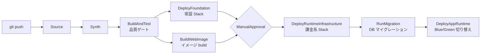
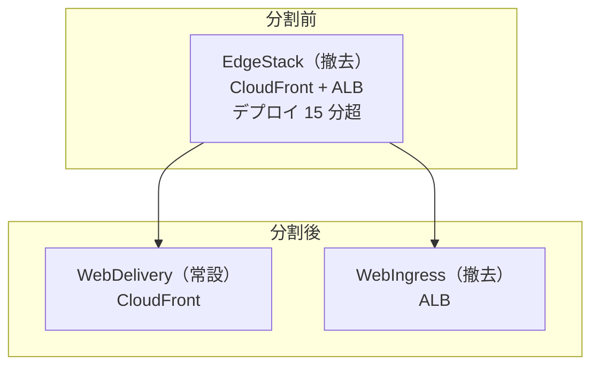
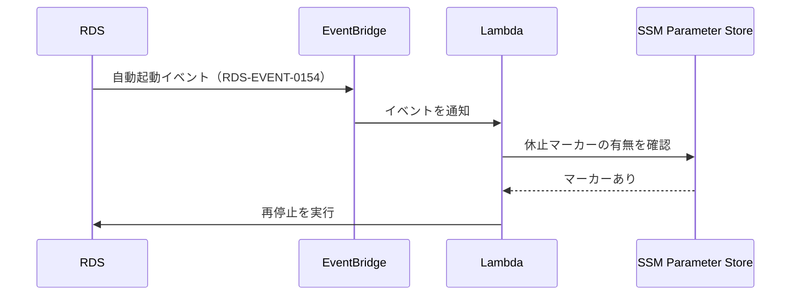
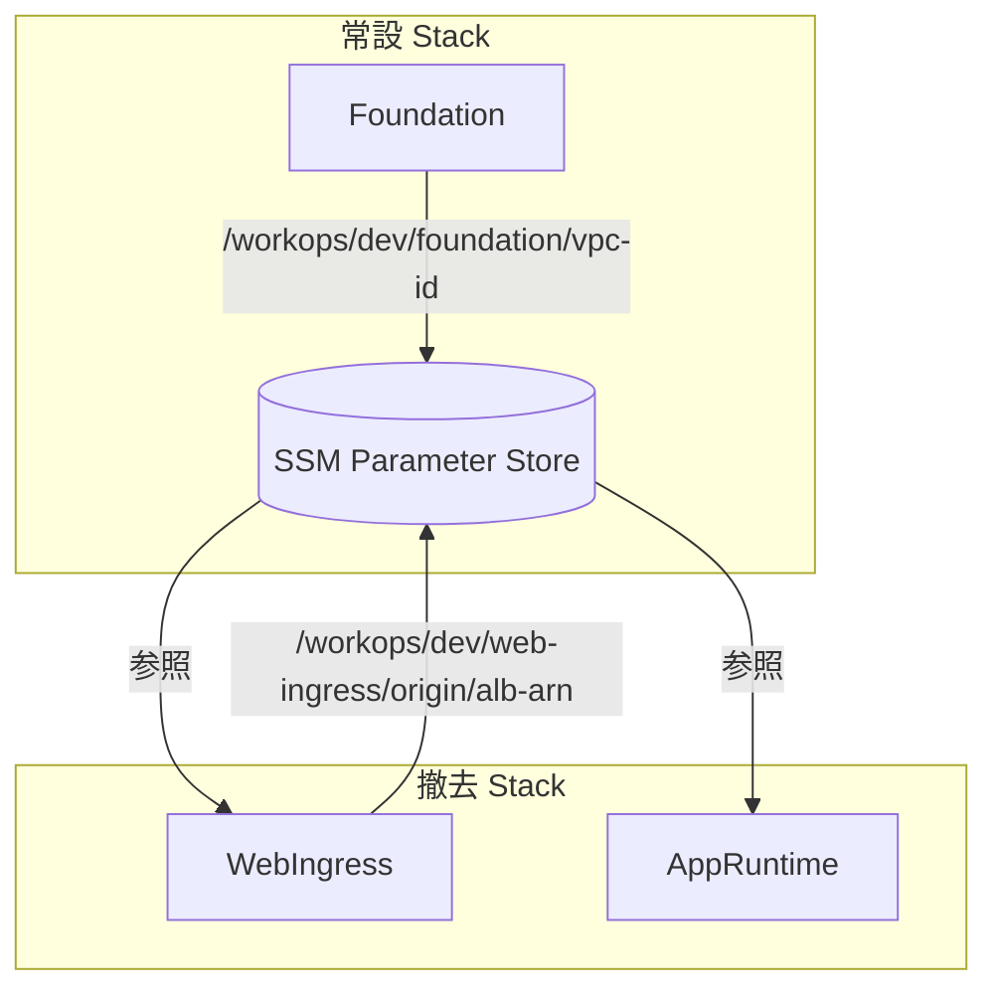
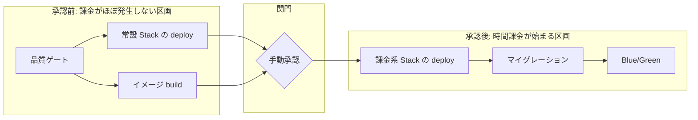
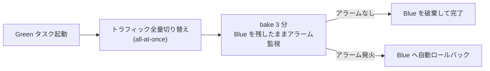

---

title: "6年目エンジニアが、さすがにCI/CDパイプラインをゼロから組んだ"
emoji: "🚚"
type: "tech"
topics:

- aws
- cdk
- codepipeline
- ecs
- cicd
- rds
published: true
published_at: 2026-07-03

---

## CI/CDパイプラインをゼロから組んだ理由

こんにちは、岩波と申します。

新卒で入社して6年目になりますが、これまで自分でCI/CDパイプラインを組んだことがありません。

普段のWebアプリケーション開発では、git pushでビルドとデプロイが実行される環境を使っています。パイプラインは別チームが管理していて、設定値を確認したり調査したりといったことはありますが、管理を主に担当した経験はありません。

さすがに6年目で主流の構成を自分で組んだことがないのはまずいと感じ、AWS上でCI/CDパイプラインをゼロから組みました。検証には、既に個人のAWS検証環境で作っていた**WorkOps**という業務アプリを流用しています。本アプリは過去にGitHub Actions経由で簡易的にCI/CDを組んでおり、バックエンドもこうしています。詳細は以下の記事にあります。

[Webサーバー構成をゼロから組んだ記事](https://zenn.dev/kyiwanami/articles/web-server-architecture)

### パイプラインの条件

パイプラインを組むにあたり、次の3つを条件にしました。

- AWSネイティブのサービスだけで完結させる<br>→シンプルな構成を目指したため
- デプロイの手前に人間の承認を挟む<br>→本番環境への反映責任を擬似的に体験するため。今回はデプロイすると課金スタックの作成が始まるため、覚悟の意味も付けています。（とはいえほぼかからない構成ですが）
- 使っていない時間帯の課金をほぼ0円に抑える<br>→検証環境のため

## 各Stackの役割

パイプライン本体と、デプロイする環境をStackに分けています。表のStack名は、実装のクラス名から末尾の`Stack`を省いたものです。

### パイプラインを動かすStack

PipelineとDependencyは、パイプライン本体と、ビルドや通知に使うサービスを管理します。

| Stack | 主なリソース | 役割 |
| --- | --- | --- |
| Pipeline | CodePipeline、CodeBuild、S3 | ソースの取得、ビルドとテスト、手動承認、各Stageのデプロイを定義する |
| Dependency | CodeArtifact、SNS | ビルドに必要な依存パッケージの取得先と、運用通知の送信先を用意する |

### 常設するStack

検証後も残すStackです。共有基盤や認証、ログ、配信などを管理します。

| Stack | 主なリソース | 役割 |
| --- | --- | --- |
| Foundation | VPC、subnet、SG、ECS Cluster、S3 Gateway Endpoint | 各Stackが使うネットワークとECSの共有基盤を用意する |
| Logs | CloudWatch Logs | ログを保存し、認証・認可の失敗件数をメトリクスとして抽出する |
| Identity | Cognito | ユーザー認証と、運営側・企業テナント側のApp Clientを管理する |
| Registry | ECR | アプリのコンテナイメージとDockerのビルドキャッシュを保存する |
| DataPause | EventBridge、Lambda | 休止中のRDSが自動で再起動したときに、再停止する |
| WebAcl | AWS WAF | CloudFrontへのリクエストをCountモードで検査する |
| WebDelivery | CloudFront、VPC Origin | HTTPSの入口を用意し、内部ALBへリクエストを転送する |

### 検証するときだけ作成するStack

検証するときに作成し、使い終わったら削除するStackです。NAT、ALB、アプリの実行環境などを管理します。

| Stack | 主なリソース | 役割 |
| --- | --- | --- |
| Egress | NAT Gateway | private subnetから外部サービスへ通信する経路を用意する |
| WebIngress | 内部ALB | CloudFrontから受けたリクエストをECSタスクへ振り分ける |
| MigrationRunner | CodeBuild | VPC内のRDSに対して、FlywayによるDBマイグレーションを実行する |
| AppRuntime | ECS Fargate、ターゲットグループ、CloudWatch Alarm | アプリを実行し、Blue/Greenの切り替えと異常時のロールバックを行う |

### 停止して残すStack

Dataは、データを残すために削除せず、RDSを停止しておきます。

| Stack | 主なリソース | 役割 |
| --- | --- | --- |
| Data | RDS MySQL | アプリのデータを保存する |

### StackをデプロイするStage

パイプライン上では、次の3つのStageで環境のStackを順にデプロイします。常設・撤去・休止は検証後の扱いを、Stageはデプロイする順序と依存関係を表しています。

| Stage | デプロイするStack |
| --- | --- |
| DeployFoundation | Foundation、Logs、Identity、Registry、DataPause |
| DeployRuntimeInfrastructure | Data、Egress、WebAcl、WebIngress、MigrationRunner、WebDelivery |
| DeployAppRuntime | AppRuntime |

## パイプラインの全体構成



手動承認は時間課金のリソースを起動する直前に1回だけ置きました。この承認で、リリースと課金開始の両方を確認します。

承認前に実行するのは、追加課金がほぼ発生しない工程だけです。基本的に、変更がなければスキップされます。

## CodePipelineとCDK Pipelinesの採用理由

実装にはCDK Pipelinesを使いました。パイプラインをCDKのコードで定義し、その変更もパイプライン経由で反映します。アプリケーション、インフラ、パイプラインを1つのリポジトリで管理できます。IaCは再現性があるので良いですね。

前記事の時点では、GitHub ActionsとOIDCを使うデプロイ構成を組んで動かしていました。その後、CodePipelineに移行しています。

| 観点 | GitHub Actions | CodePipeline + CDK Pipelines |
| --- | --- | --- |
| 組み始めの速さ | YAML 1枚で動く | 初回は概念を学ぶ必要がある |
| AWS側の権限管理 | OIDCの信頼ポリシーを別途管理 | パイプラインのロールに集約 |
| デプロイ状態の見え方 | GitHubリポジトリを確認し、必要があればAWS環境を見る | AWS内でステージごとに確認できる |

移行した決め手は、パイプラインの定義もCDKのコードとして検査やテストの対象にできることでした。インフラと同じ方法で管理できるため、パイプラインだけを手書きのYAMLで残す理由がありませんでした。

## Stackの常設・撤去・休止

CDKのStackは、使わないときに常設するか、撤去するか、休止するかで分けました。機能別の分類はしていません。使わない時間帯の課金をほぼ0円に抑えるためです。

NAT、ALB、ECSタスクなど、時間課金のリソースはすべて撤去対象のStackにまとめています。検証後に撤去対象だけを削除すれば、課金がほぼ0円に戻ります。

RDSはデータを残すため、削除せずに休止します。停止状態を維持する仕組みは、後述するRDSの自動再起動への対応で説明します。

### CloudFrontとALBのStack分割

当初、CloudFrontとALBはEdgeStackという1つのStackにまとめていました。これを撤去対象にしたところ、CloudFrontのディストリビューション作成に時間がかかり、デプロイ全体で15分も要していました。これでは撤去と再構築のたびに同じ時間が必要になり効率が非常に悪いです。そこで、WebDeliveryとWebIngressの2つに分割しました。



CloudFrontは置いたままでもほぼ課金されないため常設に移し、時間課金されるALBだけを撤去対象に残しました。ここでも、常設するか、使い終わったら削除するかでStackを分けました。

分割作業では、CloudFrontからVPC内のALBへつなぐVpcOriginの設定でつまずきました。VpcOriginEndpointConfigのArnに指定するのはALBのARNで、VpcOrigin自体のARNではありません。ドキュメントから読み取りにくい点でした。

### RDSの自動再起動への対応

休止対象のData StackにあるRDSは、停止から7日後に自動で再起動します。そのままでは、使わないときでも気づかないうちに課金が再開してしまいます。

そこで、自動起動したRDSを再停止するDataPauseを常設しました。



RDSは自動起動の際に**RDS-EVENT-0154**というイベントを発行します。EventBridgeがこのイベントを受けてLambdaを起動します。LambdaはSSM Parameter Storeの休止マーカーを確認し、再停止するか判断します。

| マーカーの状態 | 判断と処理 |
| --- | --- |
| マーカーあり | 意図しない自動起動と判断し、RDSを再停止 |
| マーカーなし。ParameterNotFound | 意図的な起動とみなし、何もしない |

このマーカーで、RDSを停止状態に保つかどうかを記録しています。

CloudTrailのログから起動理由を判定する案も検討しましたが、反映遅延で判定が不安定になるため採用しませんでした。

### Stack間の値の受け渡し

Stack間の値の受け渡しには、SSM Parameter Storeを使いました。名前を付けて値を保存できるAWSのサービスです。

パラメータ名をStack間の取り決めとして固定し、値を書き込むStackと読み出すStackで共有します。この方式を、自作の呼び名で「SSM contract」としています。



CloudFormationの標準機能であるExportとImportValueでは、参照されているStackを削除できません。撤去対象のStackを自由に削除したかったため、SSMパラメータ経由の受け渡しに切り替えました。

値を書き込むStackと読み出すStackが直接依存しなくなり、片方だけを削除できます。本番での依存性の切断に使える手法ですね。

## リリースの手順

1回のリリースは「承認前」「承認」「承認後」の3つに分かれます。

1. 検査とテストを実行し、常設Stackをデプロイしてコンテナイメージをビルドする。
2. リリースと課金開始を手動で承認する。
3. ALBやECSなどを含むStackをデプロイし、DBマイグレーションとBlue/Greenの切り替えを実行する。



### ブランチとデプロイ先

`dev`ブランチへのpushで、dev環境のパイプラインが起動します。ブランチ名からデプロイ先を決め、人が環境を指定する操作をなくしました。意図しない環境へのデプロイを防ぐためです。

### パイプラインの自己更新と復旧

CDK Pipelinesのself-mutationは、Synth → SelfMutateの順に実行し、パイプライン定義の変更を反映する仕組みです。

初回の実行ではSynthが失敗しました。CodeBuildのNode.jsが古く、依存パッケージが要求するバージョンを満たしていませんでした。npmのロックファイルの検証も通らない状態です。

Node.jsのバージョンを上げる修正をpushしても、SelfMutateはSynthの成功後に実行されるところ、Synthが失敗したままなので修正を反映する工程まで進みませんでした。

そこで、ローカルからPipelineStackを直接デプロイし、SynthのCodeBuild定義を先に更新して解決しました。通常はパイプライン経由でデプロイしています。パイプライン自体が動かなくなったときに復旧するため、ローカルからデプロイする手順も必要ですね。

### ビルド時の取得経路(CodeArtifact)

ビルド中にMaven Centralとnpmレジストリから取得する依存パッケージは、CodeArtifact経由に揃えました。CodeArtifactはAWSのパッケージリポジトリサービスです。外部レジストリへの直接アクセスをやめ、プロキシを介して障害や改ざんの影響を遮断するためです。

CodeArtifactには認証トークンが必要です。これは、BuildKit secretで渡しています。Dockerのビルド中だけ一時的にファイルとして渡し、完成したイメージには残さない仕組みです。通常のビルド引数で渡すと、トークンがコンテナイメージのレイヤーに残るためです。

アセットはS3に保存されていますが、その通信もできるだけ内部で完結させます。それには無料のGateway型エンドポイントを使いました。VPC内からS3へ直接アクセスし、NATを通る通信量を抑えています。依存パッケージのダウンロードにNATを使うとインターネットに出てしまってセキュアではありませんし、通信量に応じた料金がかかるためです。

#### Docker Hubのレート制限

ベースイメージと統合テスト用に公式イメージを取得する必要がありますが、その取得で、Docker Hubのレート制限に2回引っかかりました。

1. Dockerfileのベースイメージで、Docker Hubからeclipse-temurinを匿名で取得し、レート制限に引っかかった。
	- 対応：Amazon ECR PublicのAmazon CorrettoとAmazon Linux 2023 minimalに変更
2. Testcontainersによる統合テストで、Docker HubからMySQL 8.4を取得し、レート制限に引っかかった。
	- 対応：ECR Publicのミラーを代替イメージに指定
	- Ryuk：後始末用のコンテナもDocker Hubから取得するため、無効化

CodeBuildは毎回新しいホストで実行するため、手元にあったイメージ取得のキャッシュがありません。手元のDockerで開発したことはありますが、パイプラインに載せるときの考慮は初めて知りました。

### デプロイ前の検査

デプロイの前に、テスト、静的解析、フォーマット検査、脆弱性スキャンを実行します。検査はすべてFAILモードにし、違反を1件でも検出したらパイプラインを停止します。警告だけで続行する運用では、必ず警告が放置されて増えていくためです。ここは昨今の攻撃急増で重視すべきポイントかもしれません。

| 検査 | 対象 | 役割 |
| --- | --- | --- |
| Spotless | Java | コードフォーマットの検査 |
| SpotBugs | Java | バグパターンの静的解析 |
| JaCoCo | Java | テストカバレッジの計測（行カバレッジ80%未満で停止） |
| Trivy | コンテナイメージ | 脆弱性スキャン（MEDIUM以上で停止） |
| ESLintとPrettier | フロントエンド | 静的解析とフォーマットの検査 |

### 承認前のデプロイとビルド

検査とテストがすべて成功した後、常設Stackのデプロイとコンテナイメージのビルドを並列で実行します。どちらも時間課金のリソースを作らないため、承認前に済ませます。ビルドしたイメージはECRにpushします。

ECRのタグにはコミットのSHAを使い、同じタグへの上書きpushを禁止しました。これで、同じタグのイメージが別の中身に置き換わることを防いでいます。

- タグの変更可否：immutable
- タグ名：コミットのSHA
- イメージの保持：最新10個のみ

### 承認待ちと失敗の通知

通知は、承認待ちとパイプライン全体の失敗の2種類に絞りました。どちらも対応が必要な状態です。ステージごとの成功通知まで出すと、通知を読まなくなり、必要な対応を見落とすためです。

### 承認後のデプロイ

承認後は、ALBやECSなどを含むStackをデプロイします。続いてDBマイグレーションを実行し、アプリケーションをBlue/Greenで切り替えます。

#### DBマイグレーションの実行場所

DBマイグレーションにはFlywayを使っています。SQLファイルに版番号を付け、どこまで適用済みかをDB側に記録するマイグレーションツールです。ここはかなり悩みました。3回変わり、最終的にCodeBuildからCLIを実行する構成にしました。

CLI実行なので軽いのと、ローカル開発でもFlywayのCLIを使用しており開発体験を揃えられるのが大きいです。

| 順序 | 実行場所 | 判断の理由 |
| --- | --- | --- |
| 1回目 | アプリケーションの起動時 | Blue/Greenで新旧タスクが並行して動く間に、新スキーマの適用タイミングを制御できず、取りやめた |
| 2回目 | ECSのRunTaskで専用コンテナを実行 | 単発実行のために管理するコンテナイメージが1系統増え、負担になるため取りやめた |
| 最終形 | パイプライン内のCodeBuildからFlywayのCLIを実行 | パイプラインと手元で実行経路を揃えられる |

最終的な構成では、マイグレーション定義を独立したMavenプロジェクトに分け、次のファイルで定義しています。

```text
db/pom.xml
```

手元からも、次の2コマンドで同じマイグレーションを実行できます。

```shell
cd db
mvn -Pdev flyway:migrate
```

WorkOpsでは今後、外部提供APIと重いバッチ処理を、Webとは別のアプリに分ける構想があります。マイグレーション定義を分けたのは、この構想にも関係しています。

| アプリケーション | 配置先 |
| --- | --- |
| Web | `apps/web` |
| 外部提供API | `apps/api` |
| 重いバッチ処理 | `apps/batch` |

Webアプリの起動時にマイグレーションを実行すると、DBスキーマの管理がWebアプリに紐づきます。APIやバッチも同じDBを使うようになると、どのアプリがスキーマを管理するのか曖昧になります。

そこで、DBスキーマの管理元を`db/`にまとめ、特定のアプリから切り離しました。アプリが増えても、DBスキーマはこの1か所で管理します。マイグレーションも、DBのライフサイクルに関わる処理として扱います。

この過程で、ビルド環境と実行環境のアーキテクチャも統一しました。AWS製のARMプロセッサであるGravitonに揃え、環境の違いによる不具合の可能性をなくしています。

#### Blue/Greenの切り替え

Blue/Greenでは、旧タスク群のBlueを残したまま、新タスク群のGreenを起動してトラフィックの向き先を切り替えます。旧タスクは動き続けているので、問題があればトラフィックを戻して復旧できます。

今回はECSネイティブのBlue/Green機能で、トラフィックを一度に全量切り替える設定にしました。個人環境には段階的な切り替えを観察する対象ユーザーがいないため、切り替え後の監視を手厚くしています。



切り替え後は、bakeと呼ばれる猶予時間を設け、旧タスクを残したままアラームを監視します。

- トラフィックの切り替え：all-at-onceで全量を一度に切り替え
- bake：3分

この3分の間は、次の2つのアラームを監視します。

| アラーム条件 | 検出する状態 |
| --- | --- |
| `HealthyHostCount < 1` | 問題なしのタスクが1つもない |
| `UnHealthyHostCount > 0` | 問題ありのタスクが1つでもある |

どちらかのアラームが作動すると、旧タスクへ自動でロールバックします。

bakeを置くのは、アプリケーションが起動直後は正常に見えても、数十秒後に停止することがあるためです。

- ヘルスチェック：`/actuator/health`を30秒間隔で実行し、Spring Actuatorの応答で判定
- 起動猶予：90秒。Spring Bootの起動完了まで、ヘルスチェックの失敗を無視
- デタッチ待ち：30秒。切り替え時に処理中のリクエストを完了させる
- デプロイ中の台数：min 100% / max 200%。旧タスクを残したまま新タスクを追加
- circuit breakerのrollback：有効。起動失敗を繰り返す場合も自動で戻す

アラームでは、BlueとGreen両方のターゲットグループのメトリクスを数式で合算しています。タスクがどちらの群にあるかに関係なく、全体の健全性を確認します。

## デプロイの所要時間

pushからパイプラインの完了までの時間も計測しました。1回目は環境をゼロから作成し、2回目はWebアプリの変更だけを反映しています。手動承認の待ち時間は除いています。

| 区間 | 初回 | 日常の変更 |
| --- | --- | --- |
| Sourceからパイプラインの自己更新まで | 約6分 | 約4分 |
| 検査とテスト | 4分07秒 | 4分07秒 |
| 常設Stackのデプロイ | 約5分 | 1分12秒 |
| イメージのビルドとスキャン | 3分36秒 | 3分36秒 |
| 承認後のStackデプロイ | 約25分 | 1分50秒 |
| マイグレーションとBlue/Green | 約6分 | 約9分 |
| 合計 | 約50分 | 約26分 |

初回に時間がかかったのは、承認後のStackデプロイです。特にCloudFrontとRDSの作成に時間がかかりました。

| Stack | 含まれるリソース | 初回の所要時間 |
| --- | --- | --- |
| WebDelivery | CloudFront | 12分59秒 |
| Data | RDS | 7分51秒 |

日常の実行ではどちらも作り直さないため、この時間はかかりません。前述のEdgeStackの分割でCloudFrontを常設側に移し、毎回作成する必要がなくなりました。

bakeの3分は監視のために残します。Synth、パイプラインの自己更新、アセット転送、検査とテストは直列に実行しており、コードを1行変えただけでも約8分かかります。パイプライン定義の変更にも検査とテストを実行する構成にしたため、毎回この時間が必要です。

ここはかなり課題ですね。本筋ではなかったので見逃していますが、AI開発で機能実現のスピードが上がっている今、デリバリーをボトルネックにはしたくありません。

チームで使うなら、まず検査とテストを並列に実行するところから手を付けると思います。

## WAFとセキュリティメトリクス

セキュリティ面では、WAFによる検出と、認証・認可の失敗件数を記録する仕組みを追加しました。

### WAFの構成

CloudFront用のWebACLはus-east-1に作る必要があります。WebAclを独立したStackにし、CDKのリージョン間参照でARNを東京リージョン側のCloudFrontに渡しています。

- WebACLの作成先：us-east-1
- WebACLを定義するStack：WebAcl
- ルール：AWS Managed RulesのCommon Rule Set
- 動作モード：Countで有効化
- ログの保存先：必須の接頭辞`aws-waf-logs-`を付けたLogGroup
- ログの保持期間：1週間

#### WAFのARNとリージョン間参照

CloudFront用のWAFは、東京リージョンのアプリケーションとは別のリージョンに作る制約があります。WAFのARNを他の値と同じようにSSM contractで公開したところ、WebDeliveryでパラメータが見つからず、デプロイに失敗しました。

SSM Parameter Storeはリージョンごとのサービスなので、us-east-1に書いた値を東京リージョンから参照できません。WAFのARNだけは、CDKのリージョン間参照で渡しました。

Stack間の値をSSM contractで渡す方針に対して、リージョンをまたぐこの値だけが例外です。

### 認証・認可の失敗件数

アプリケーションが出す構造化ログから、認可の拒否やユーザー情報の照合失敗をCloudWatch Logsのメトリクスフィルターで抽出し、件数を記録しています。

- メトリクスフィルター：6本
- メトリクスの名前空間：WorkOps/Security

抽出するログには、次のものなどがあります。

- 認可の拒否
- CognitoユーザーとDBユーザーの照合失敗
- actor typeの不整合
- 権限セットの未割り当て

アラームとダッシュボードはあえて付けず、攻撃や設定ミスの痕跡を後から件数で確認できるようにしました。

## 個人検証環境で省いた構成

個人の検証には不要と判断したものは、次のとおりです。

- SLO：未定義。監視対象のユーザーがいないため、アラーム2本で足りると判断した。
- KMSのCMK：不使用。自分で管理する暗号鍵とAWS管理鍵との差分が、鍵の管理コストに見合わなかった。
- WAFのBlockモード：不使用。Countモードで検出だけ行い、遮断しないことで誤遮断の調査コストを避けた。
- メトリクスのダッシュボード：未作成。日常的に確認する規模ではないため、アラームで異常を知らせる方式を採用した。
- パイプラインのロール：細分化を省略。単一アカウントの個人環境では、GitHub側のブランチ保護で変更を制限する方針を許容した。

CDK Pipelinesのself-mutationでは、パイプラインの定義をパイプライン経由で更新できます。この構成では、パイプラインのロールが事実上インフラ全体の変更権限を持ちます。業務なら、デプロイロールの分離と承認が必要な範囲の設計は必須です。

省いた理由も書き残すことを、このポートフォリオ全体の方針にしています。

## おわりに

CI/CDを実際に組んで、ソース反映からBlue/Greenデプロイまでの流れを自分で組み立てられるようになりました。

特に、課金スタックと非課金スタックを分け、前者は再現性を持ち後者は保持するという非機能要件を作ったことで、それに対する設計判断を行うのも楽しかったです。特にRDBはデータを保ちつつできるだけ休眠状態に保つ部分はかなり拘りました。

一方で、監視と障害対応、DBのバックアップとリストアのような運用の領域は、まだ任せきりのままです。次は運用についても、自分で設計し、その理由を説明できるようにしていきます。

## ソースコード

構成はすべて次のリポジトリにあります。

@[card](https://github.com/kyiwanami/workops)

## 参考資料

- [CodePipeline](https://docs.aws.amazon.com/codepipeline/latest/userguide/welcome.html)
- [CDK Pipelines](https://docs.aws.amazon.com/cdk/v2/guide/cdk-pipeline.html)
- [ECRのタグの変更可否](https://docs.aws.amazon.com/AmazonECR/latest/userguide/image-tag-mutability.html)
- [ECSネイティブのBlue/Green機能](https://docs.aws.amazon.com/AmazonECS/latest/developerguide/deployment-type-blue-green.html)
- [SSM Parameter Store](https://docs.aws.amazon.com/systems-manager/latest/userguide/systems-manager-parameter-store.html)
- [CloudFormationのExportとImportValue](https://docs.aws.amazon.com/AWSCloudFormation/latest/UserGuide/using-cfn-stack-exports.html)
- [RDSの停止と再起動](https://docs.aws.amazon.com/AmazonRDS/latest/UserGuide/USER_StopInstance.html)
- [CodeArtifact](https://docs.aws.amazon.com/codeartifact/latest/ug/welcome.html)
- [BuildKit secret](https://docs.docker.com/build/building/secrets/)

<empty-block/>
