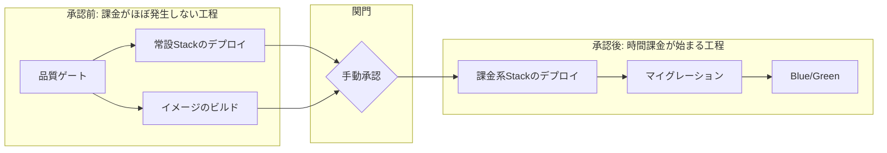
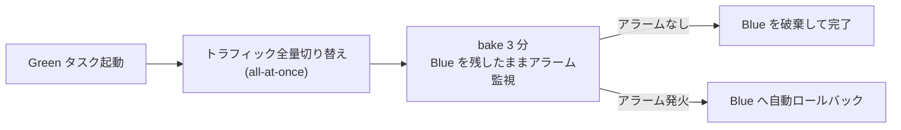
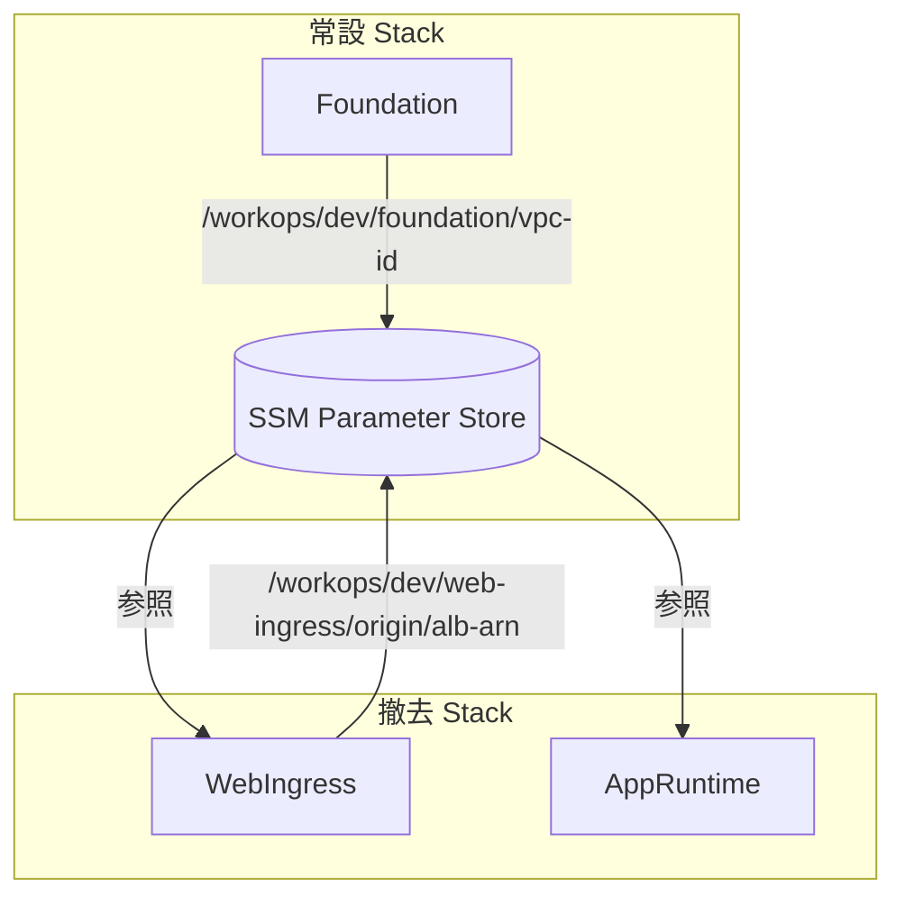
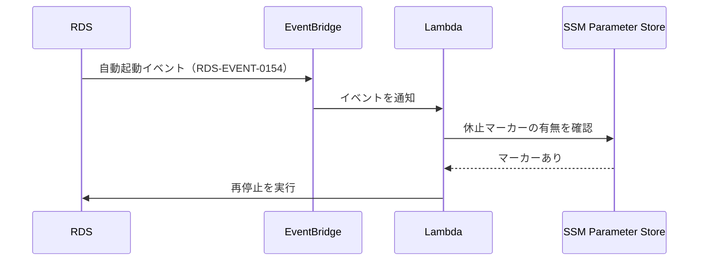
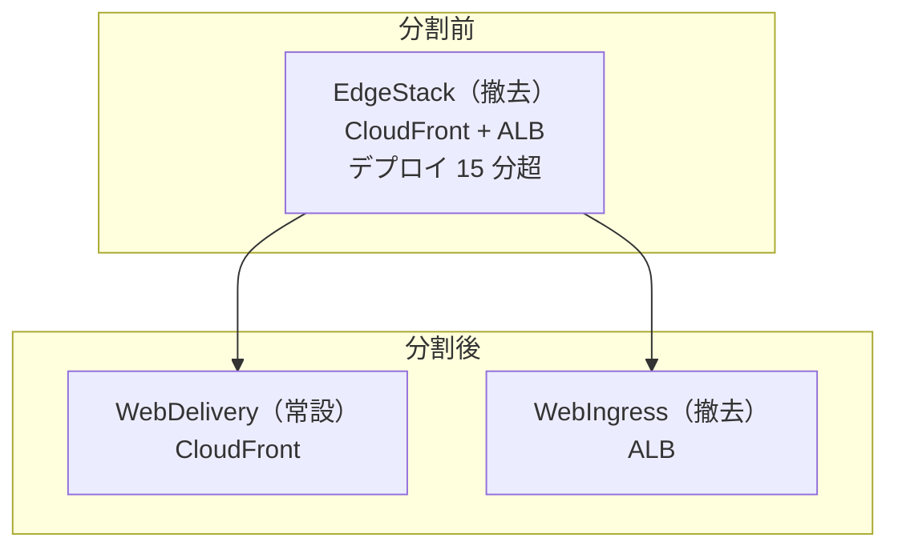

---

title: "6年目エンジニアが、さすがにCI/CDパイプラインをゼロから組んだ"
emoji: "🚚"
type: "tech"
topics:

- aws
- cdk
- codepipeline
- ecs
- cicd
- rds
published: true
published_at: 2026-07-03

---
## はじめに

こんにちは、岩波と申します。

エンジニア6年目になりますが、CI/CDパイプラインを自分で組んだことがありませんでした。

業務では、常に整備済みのパイプラインで開発してきました。pushすればビルドとデプロイが実行される環境を、当たり前のものとして使っていました。

パイプラインは別チームが管理しており、私には触る権限がありませんでした。できるのは、管理者に質問し、見える範囲を自分で確認することまででした。

そこで、個人のAWS検証環境WorkOpsに、CI/CDパイプラインをゼロから組みました。

WorkOpsはWebサーバー構成を自分で設計するために作った検証環境で、その経緯は[前記事](https://zenn.dev/kyiwanami/articles/web-server-architecture)に書いています。

この記事だけで構成と設計の理由が分かるように書いています。前記事の知識は前提にしません。

今回のパイプラインでは、次の3つを条件にしました。

- AWSネイティブのサービスだけで完結させる
- デプロイの手前に人間の承認を挟む
- 使っていない時間帯の課金をほぼ0円に抑える

この記事では、完成した構成から順に、この3つを満たすためにどのように設計したかを説明します。

## 組んだもの

完成形のパイプラインは次のとおりです。

図には、実際の[CodePipeline](https://docs.aws.amazon.com/codepipeline/latest/userguide/welcome.html)のステージ名を使っています。リポジトリのコードも同じ名前で定義しています。

実装には[CDK Pipelines](https://docs.aws.amazon.com/cdk/v2/guide/cdk-pipeline.html)を使いました。パイプライン自体をCDKのコードで定義し、そのコードの変更もパイプライン経由で反映する仕組みです。アプリケーション、インフラ、パイプラインを1つのリポジトリで管理できます。

設計の中心は、課金が始まる直前に手動承認を1回だけ置くことです。

承認より前には、実行しても追加課金がほぼ発生しない工程だけを置いています。

承認すると、ALBやECSタスクのような時間課金のリソースが起動します。この承認で「リリースしてよいか」と「ここから課金してよいか」の両方を確認します。

### GitHub ActionsからCodePipelineに移行した

前記事の時点では、GitHub ActionsとOIDCを使うデプロイ構成を組んで動かしていました。その後、[CodePipeline](https://docs.aws.amazon.com/codepipeline/latest/userguide/welcome.html)に移行しています。

両方組んで感じた差は次のとおりです。

| 観点 | GitHub Actions | CodePipeline + CDK Pipelines |
| --- | --- | --- |
| 組み始めの速さ | YAML 1枚で動く | 初回は概念を学ぶ必要がある |
| AWS側の権限管理 | OIDCの信頼ポリシーを別途管理 | パイプラインのロールに集約 |
| デプロイ状態の見え方 | AWSの外から結果だけ見える | AWS内でステージごとに確認できる |
| パイプライン自体の変更 | YAMLを手で編集 | CDKコードとして品質ゲートを通る |

決め手は、パイプライン自体の変更もCDKのコードとして品質ゲートを通せることでした。インフラをコードで管理するなら、パイプラインだけ手書きのYAMLで残す理由がありませんでした。

この記事で扱うのは、CodePipelineに移行した後の構成です。

## リリースの流れを辿る

1回のリリースは「承認前」「承認」「承認後」の3つに分かれます。パイプラインの最初の工程から順に辿ります。

### デプロイ対象の環境はブランチ名で決まる

デプロイ対象の環境はブランチ名で決まります。`dev`ブランチへのpushで、dev環境のパイプラインが起動します。

人がデプロイ先の環境を指定する操作をなくし、意図しない環境にデプロイする事故を防いでいます。

### 品質ゲートは違反を検出した時点でパイプラインを止める

最初に品質ゲートで検査します。すべての検査をFAILモードにし、違反を1件でも検出した時点でパイプラインを止める設定にしています。

警告だけで処理を続ける運用では、必ず警告が放置されて増えていくためです。

検査の内訳は次のとおりです。

| 検査 | 対象 | 役割 |
| --- | --- | --- |
| Spotless | Java | コードフォーマットの検査 |
| SpotBugs | Java | バグパターンの静的解析 |
| JaCoCo | Java | テストカバレッジの計測（行カバレッジ80%未満で停止） |
| Trivy | コンテナイメージ | 脆弱性スキャン（MEDIUM以上で停止） |
| ESLintとPrettier | フロントエンド | 静的解析とフォーマットの検査 |

### 承認前に時間課金のリソースを作らない工程を済ませる

品質ゲートを通過すると、常設Stackのデプロイとコンテナイメージのビルドを並列で実行します。どちらも時間課金のリソースを作らないため、承認前に実行できます。

ビルドしたイメージはECRにpushします。

ECRのタグは[immutable](https://docs.aws.amazon.com/AmazonECR/latest/userguide/image-tag-mutability.html)に設定し、同じタグ名での上書きpushを禁止しています。タグにはコミットのSHAを使い、「同じタグなのに中身が違う」という状態を作れないようにしました。イメージは最新10個だけ保持します。

Trivyのスキャンはpushより前に実行しています。脆弱性のあるイメージをレジストリに置かないためです。

### 通知は承認待ちとパイプライン全体の失敗の2種類に絞る

通知を出すのは、承認待ちになったときと、パイプライン全体が失敗したときの2つだけです。ステージごとの成功通知は出しません。

通知が多いと読まなくなり、対応が必要なこの2つを見落とすためです。

### 承認後に課金系リソースを作り、Blue/Greenで切り替える

承認すると、ALBやECSサービスを含む課金系Stackをデプロイします。続いてDBマイグレーションを実行し、最後にアプリケーションを**Blue/Green**で切り替えます。

Blue/Greenは、旧タスク群（Blue）を残したまま新タスク群（Green）を立ち上げ、トラフィックの向き先を切り替えるデプロイ方式です。

切り替え中も旧タスクは動いているため、問題があればトラフィックの向き先を戻すだけで復旧できます。

[ECSネイティブのBlue/Green機能](https://docs.aws.amazon.com/AmazonECS/latest/developerguide/deployment-type-blue-green.html)を使い、切り替えはall-at-once、つまりトラフィックを一度に全量切り替える設定にしました。

個人環境では段階的な切り替えを観察する対象ユーザーがいないため、一度に切り替え、切り替え後の監視を手厚くしています。

切り替え後には**bake**の時間を3分置いています。bakeは旧タスクをすぐには破棄せず、アラームを監視しながら待つ猶予時間です。

この3分の間は、次の2つのアラームを監視します。

- HealthyHostCount < 1（健全なタスクが1つもない）
- UnHealthyHostCount > 0（不健全なタスクが1つでもある）

どちらかのアラームが作動すると、旧タスクへ自動でロールバックします。

bakeを置くのは、アプリケーションが起動直後は正常に見えても、数十秒後に停止することがあるためです。

Blue/Greenを支える設定値は次のとおりです。

| 設定 | 値 | 意図 |
| --- | --- | --- |
| ヘルスチェック | `/actuator/health`を30秒間隔 | Spring Actuatorの応答で判定 |
| 起動猶予 | 90秒 | Spring Bootの起動完了までヘルスチェック失敗を無視 |
| デタッチ待ち | 30秒 | 切り替え時に処理中のリクエストを完了させる |
| デプロイ中の台数 | min 100% / max 200% | 旧タスクを残したまま新タスクを追加 |
| circuit breaker | rollback有効 | 起動失敗を繰り返す場合も自動で戻す |

アラームでは、BlueとGreen両方のターゲットグループのメトリクスを数式で合算しています。タスクがどちらの群にあるかに関係なく、全体の健全性を確認します。

### pushからパイプライン完了までの実測

pushからパイプラインの完了までの時間も計測しました。1回目は環境をゼロから作成し、2回目はWebアプリの変更だけを反映しています。手動承認の待ち時間は除いています。

| 区間 | 初回 | 日常の変更 |
| --- | --- | --- |
| Sourceからパイプラインの自己更新まで | 約6分 | 約4分 |
| 品質ゲート | 4分07秒 | 4分07秒 |
| 常設Stackのデプロイ | 約5分 | 1分12秒 |
| イメージのビルドとスキャン | 3分36秒 | 3分36秒 |
| 課金系Stackのデプロイ | 約25分 | 1分50秒 |
| マイグレーションとBlue/Green | 約6分 | 約9分 |
| 合計 | 約50分 | 約26分 |

初回と日常の変更で差が出るのは、課金系Stackのデプロイです。初回はCloudFrontを含むWebDeliveryに12分59秒、RDSを含むDataに7分51秒かかりました。

日常の実行ではどちらも作り直さないため、この時間はかかりません。後述するEdgeStackの分割でCloudFrontを常設側に移し、毎回作成する必要がなくなりました。

正直、日常の変更で26分は速くないです。

bakeの3分は監視のために置いた時間なので削りません。一方、Synth、パイプラインの自己更新、アセット転送、品質ゲートにかかる約8分は、コードを1行変えただけでも毎回必要です。これらの工程は直列に実行しています。

パイプライン定義の変更もコードとして品質ゲートを通すために、この時間がかかります。

1人で使う分には許容しました。チームで使うなら、まず品質ゲートの並列化から手を付けると思います。

## Stackをライフサイクルで分ける

使わない時間帯の課金をほぼ0円に抑えるため、CDKのStackをライフサイクルで3つに分類しました。機能による分類はしていません。

| 分類 | 扱い | 該当Stack |
| --- | --- | --- |
| 常設 | 置いたままでも課金がほぼ0円 | Foundation, Logs, Identity, Registry, DataPause, WebAcl, WebDelivery |
| 撤去 | 使い終わったら削除する | Egress, WebIngress, MigrationRunner, AppRuntime |
| 休止 | 削除せず停止する | Data |

NAT、ALB、ECSタスクなど、時間課金のリソースはすべて撤去対象のStackにまとめています。検証後に撤去対象だけを削除すれば、課金がほぼ0円に戻ります。

RDSは削除するとデータが消えるため、休止という第3の分類を設けました。停止した状態を維持する仕組みは次の章で説明します。

CDK Pipelines上では3つのStageを実装しています。PermanentStageが常設、RuntimePrereqStageが実行の前提、AppRuntimeStageがアプリケーション本体です。

分類をまたぐ値の受け渡しには**SSM contract**という方式を採りました。

[SSM Parameter Store](https://docs.aws.amazon.com/systems-manager/latest/userguide/systems-manager-parameter-store.html)は、名前を付けて値を保存できるAWSのサービスです。パラメータ名をStack間の取り決めとして固定する方式を、自作の呼び名で「SSM contract」としています。

[CloudFormationにはExportとImportValue](https://docs.aws.amazon.com/AWSCloudFormation/latest/UserGuide/using-cfn-stack-exports.html)という標準の受け渡し機能があります。ただし、これを使うと参照されているStackを削除できません。

撤去対象のStackを自由に削除する方針に合わないため、SSMパラメータ経由の受け渡しに切り替えました。

値を公開するStackと参照するStackが、互いを直接参照する必要がないため、片方だけを削除できます。

## RDSを止めたまま維持する仕組み

休止対象のData Stackでは、[RDSが停止から7日後に自動で再起動する仕様](https://docs.aws.amazon.com/AmazonRDS/latest/UserGuide/USER_StopInstance.html)が問題になりました。放置すると、気づかないうちに課金が再開します。

これを防ぐために**DataPause**という常設の仕組みを作りました。

RDSは自動起動の際にRDS-EVENT-0154というイベントを発行します。

EventBridgeがこのイベントを受けてLambdaを起動し、LambdaはSSM Parameter Storeの休止マーカーを確認します。マーカーがあれば、意図しない自動起動と判断してRDSを再停止します。マーカーがなくParameterNotFoundになれば、意図的な起動とみなして何もしません。

RDSを停止したままにするかどうかをSSMのマーカーで記録し、自動起動したときに確認する仕組みです。

CloudTrailのログから起動理由を判定する案も検討しましたが、ログの反映遅延で判定が不安定になるため不採用にしました。

## 組む途中で設計を見直した箇所

計画どおりに進まなかった箇所を3つ書きます。

### EdgeStackをデプロイ時間で分割した

当初、CloudFrontとALBはEdgeStackという1つのStackにまとめていました。これを撤去対象にしたところ、デプロイに15分11秒かかりました。

CloudFrontのディストリビューション作成に時間がかかり、撤去と再構築のたびに同じ時間が必要になります。そこで、WebDeliveryとWebIngressの2つに分割しました。

CloudFrontは置いたままでもほぼ課金されないため常設に移し、時間課金されるALBだけを撤去対象に残しました。

この分割も、前章と同じくライフサイクルを基準にしています。機能やコストによる分類はしていません。

分割作業では、CloudFrontからVPC内のALBへ直接つなぐVpcOriginの設定で1か所つまずきました。

VpcOriginEndpointConfigのArnには、ALBのARNを指定します。VpcOrigin自体のARNは指定しません。ドキュメントからは読み取りにくい仕様でした。

### DBマイグレーションの実行場所を3回変えた

DBマイグレーションには**Flyway**を使っています。SQLファイルに版番号を付け、どこまで適用済みかをDB側に記録するマイグレーションツールです。Flywayの実行場所は3回変わりました。

1回目は、アプリケーションの起動時に実行する構成でした。Blue/Greenと組み合わせると、新旧のタスクが並行して動く間に新スキーマの適用タイミングを制御できないため、この構成はやめました。

2回目は、ECSのRunTaskでマイグレーション専用コンテナを実行する案でした。RunTaskはタスクを1回だけ単発実行するAPIです。マイグレーションのためだけに管理するコンテナイメージが1系統増え、負担になるため、この案もやめました。

最終的に、パイプライン内のCodeBuildからFlywayのCLIを実行する構成にしました。

マイグレーション定義は`db/pom.xml`という独立したMavenプロジェクトに分けました。そのため、手元からも`cd db; mvn -Pdev flyway:migrate`の2コマンドで同じマイグレーションを実行できます。

パイプラインと手元で実行経路を揃えられたことが、この構成にした決め手でした。

WorkOpsでは今後、外部提供APIを`apps/api`、重いバッチ処理を`apps/batch`として、Webとは別のアプリに分ける構想があります。マイグレーション定義を分けたのは、この構想にも関係しています。

`apps/web`の起動時にマイグレーションを実行するままだと、DBスキーマの正本がWebアプリ1つに紐づきます。APIやバッチが同じDBを使い始めると、スキーマを誰が管理するのかが曖昧になります。

`db/`に分けることで、マイグレーションをDBそのもののライフサイクルに関わる処理として扱っています。特定のアプリが管理する処理にはしていません。

アプリが何個に増えても、DBスキーマの正本は`db/`の1か所のままです。

この過程で、ビルド環境と実行環境のアーキテクチャもARM_64に統一しました。

実行基盤をAWS製のARMプロセッサであるGravitonに揃えることで、ビルド環境と実行環境の違いによる不具合の可能性をなくしています。

### 依存パッケージの取得経路をCodeArtifactに一本化した

ビルド中の依存パッケージは、AWSのパッケージリポジトリサービスである[CodeArtifact](https://docs.aws.amazon.com/codeartifact/latest/ug/welcome.html)経由で取得するようにしました。Maven Centralとnpmレジストリへの直接アクセスはやめました。

プロキシを介して、外部レジストリの障害や改ざんの影響を遮断するためです。

CodeArtifactの認証トークンをビルド時の通常の引数で渡すと、コンテナイメージのレイヤーに残ります。そこで、[BuildKit secret](https://docs.docker.com/build/building/secrets/)を使いました。ビルド中だけ一時的にファイルとして値を渡し、完成したイメージには痕跡を残さないDockerの仕組みです。

また、依存パッケージのダウンロードがNATを経由すると、通信量に応じた料金がかかります。

S3への通信にはGateway型エンドポイントを使い、NATを通過する通信量を抑えました。NATを経由せず、VPC内からS3へ直接到達する無料の経路です。

## 初めてパイプラインが完了するまでにつまずいた箇所

パイプラインは最初の実行では完了しませんでした。

ここでは、同じ構成であれば遭遇するはずの問題を3つ書きます。作業ミスは省きます。

### Synthが失敗すると、パイプラインを修正する変更も反映できない

CDK Pipelinesのself-mutationは、Synth → SelfMutateの順に実行し、パイプライン定義の変更を反映する仕組みです。

初回の実行では、Synthが失敗しました。CodeBuildのNode.jsが古く、依存パッケージが要求するバージョンを満たしていませんでした。npmのロックファイルの検証も通らない状態です。

Node.jsのバージョンを上げる修正をpushしても、その変更を反映するSelfMutateはSynthが成功した後に実行されます。Synth自体が失敗する状態では、修正もパイプライン経由で反映できません。ここで、パイプライン経由では直せないことに気づきました。

ローカルからPipelineStackを直接デプロイし、SynthのCodeBuild定義を先に更新して解決しました。

通常はパイプライン経由でデプロイしています。パイプライン自体が動かなくなったときに復旧するため、ローカルからデプロイする手順も残しています。

### Docker Hubのレート制限に2回引っかかった

依存パッケージの取得はCodeArtifactに一本化したはずでした。それでもビルドが失敗しました。

1回目はDockerfileのベースイメージでした。eclipse-temurinをDocker Hubから匿名で取得し、レート制限に引っかかりました。

CodeBuildは毎回新しいホストで実行するため、手元にあったイメージ取得のキャッシュがありません。

ベースイメージは、Amazon ECR PublicのAmazon CorrettoとAmazon Linux 2023 minimalに替えました。

2回目は品質ゲートの統合テストでした。TestcontainersがMySQL 8.4のイメージをDocker Hubから取得していたため、ECR Publicのミラーを代替イメージに指定しました。

Testcontainersが後始末用に起動するRyukコンテナもDocker Hubから取得するため、無効化しました。

Mavenとnpmだけを見て、依存パッケージの取得経路を揃えたつもりでした。コンテナイメージも依存の一部ですが、取得経路の確認から丸ごと漏れていました。

### SSM contractはリージョンをまたげない

CloudFront用のWAFはus-east-1に作るという制約があります。WAFのARNを他の値と同じようにSSM contractで公開したところ、東京リージョン側のWebDeliveryでパラメータが見つからず、デプロイに失敗しました。

SSM Parameter Storeの値はリージョン内で参照するため、us-east-1に書いた値は東京リージョンからは見えません。そのため、WAFのARNだけはCDKのリージョン間参照で渡しました。SSMは使っていません。

Stack間の値はSSM contractで渡す方針ですが、リージョンをまたぐこの値だけは例外です。

## WAFとセキュリティメトリクス

この構成に追加したセキュリティの仕組みを2つ説明します。

### WAFのWebACLはus-east-1に作る

CloudFrontにWAFを付ける場合、WebACLはus-east-1に作る必要があります。

そこでWebAclだけ独立したStackにし、CDKのリージョン間参照でARNを東京リージョン側のCloudFrontに渡しています。

ルールはAWS Managed RulesのCommon Rule SetをCountモードで有効化しました。

ログは、必須の接頭辞である`aws-waf-logs-`を付けたLogGroupに1週間だけ保持しています。

### 認証・認可の失敗はメトリクスとして数えている

アプリケーションは、認可の拒否やユーザー情報の照合失敗を構造化ログとして出しています。

CloudWatch Logsの6本のメトリクスフィルターでこのログを抽出し、WorkOps/Securityという名前空間のメトリクスに変換しています。

対象は認可の拒否、CognitoユーザーとDBユーザーの照合失敗、actor typeの不整合、権限セットの未割り当てなどです。

アラームとダッシュボードはあえて付けず、攻撃や設定ミスの痕跡を後から件数で確認できるようにしました。

## 個人検証環境で省いたもの

業務なら用意するものでも、この環境の目的には過剰と判断して省いたものがあります。

- 数値のSLO。監視対象のユーザーがいないため、アラーム2本の構成で足りると判断しました
- stagingとprodの分離。環境はブランチで増やせる構造にしてあり、常設はしていません
- KMSのCMK（自分で管理する暗号鍵）。AWS管理鍵との差分が鍵の管理コストに見合いませんでした
- WAFのBlockモード。ルールはCountモード、つまり検出だけ行い遮断しない設定で有効化し、誤遮断の調査コストを避けました
- メトリクスのダッシュボード。日常的に確認するほどの規模ではないため、アラームで異常を知らせる方式にしました
- パイプラインのロールの細分化。CDK Pipelinesのself-mutationでは、パイプラインの定義をパイプライン経由で更新できます。この構成では、パイプラインのロールが事実上インフラ全体の変更権限を持ちます。業務ならデプロイロールの分離と承認が必要な範囲の設計は必須ですが、単一アカウントの個人環境では、GitHub側のブランチ保護で変更を制限する方針を許容しました

省いた理由も書き残すことを、このポートフォリオ全体の方針にしています。

## ソースコード

構成はすべて次のリポジトリにあります。

@[card](https://github.com/kyiwanami/workops)

## おわりに

任せきりだったCI/CDを実際に組んで、pushからBlue/Greenまでの流れを自分で組み立てられるようになりました。

組んでみて分かったのは、業務で使ってきたパイプラインの構成が、どれも誰かの設計判断の結果だったということです。

品質ゲートや承認をどこに置くか、どんな条件でロールバックするか。使う側だったときは仕様として受け入れていたものも、いまは設計時にどんな判断をしたかが分かります。

次に業務でパイプラインの管理側と話すとき、話せる内容が変わっているはずです。

一方で、監視と障害対応、DBのバックアップとリストアのような運用の領域は、まだ任せきりのままです。

次は運用についても、自分で設計し、その理由を説明できるようにしていきます。
