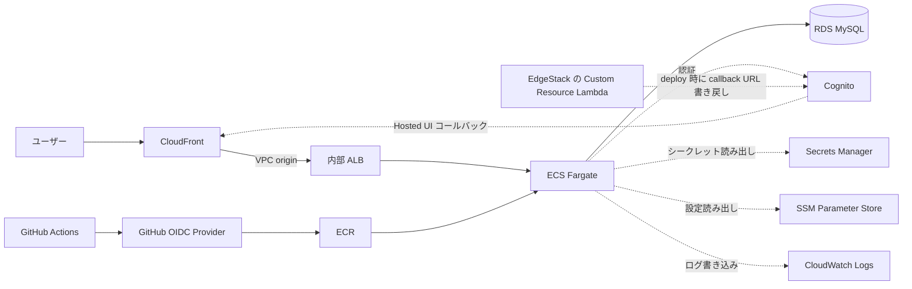
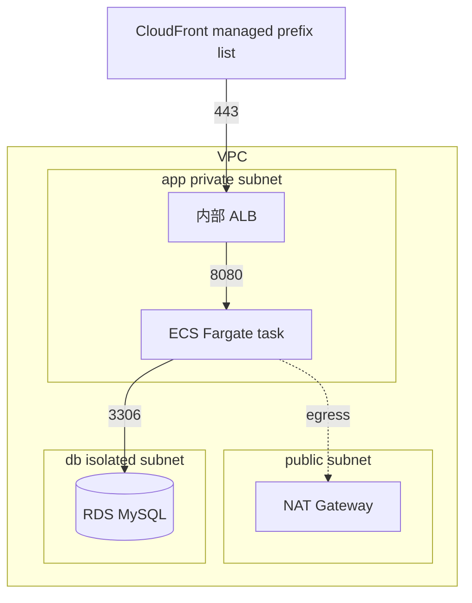
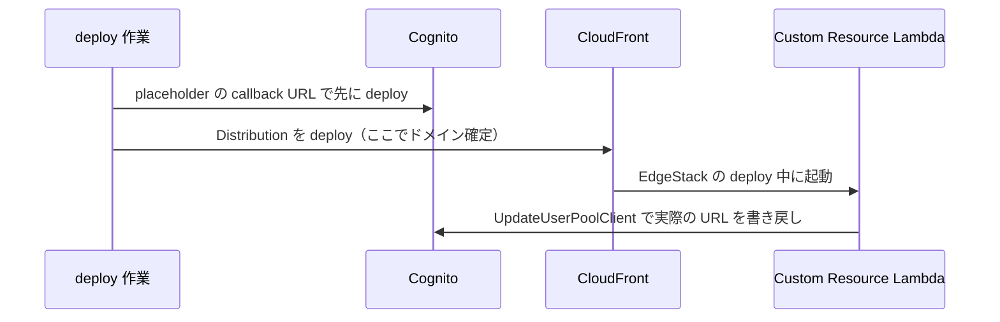
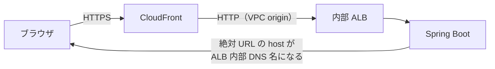
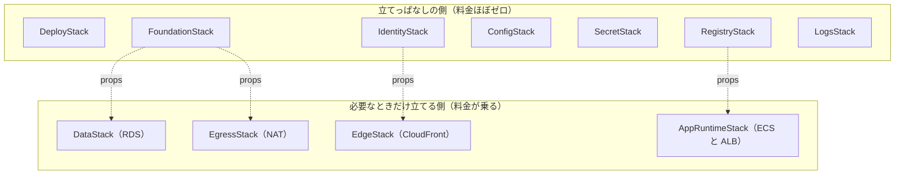
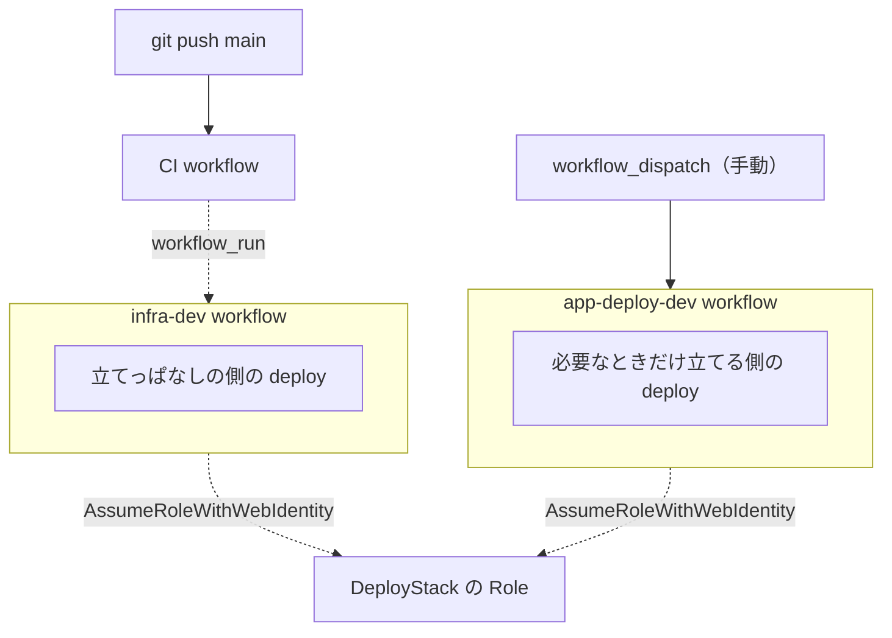
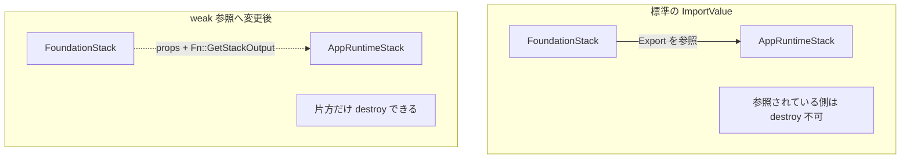
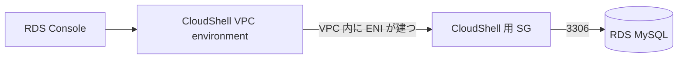

## Webサーバー構成をゼロから組んだ理由

こんにちは。エンジニアの岩波と申します。

新卒で入社して6年目になりますが、これまで自分でWebサーバー構成を組んだことがありません。

ここ2年ほどは、AWS Amplifyのようなサーバーレス構成でWebアプリケーションを開発しています。Amplifyは小規模なアプリケーション向けのマネージドサービスであり開発に集中できますが、その裏返しとしてインフラに触れる機会は殆どありません。

それ以前の3年半は、ECS Fargate上のSpring Bootアプリと、それを動かすCodePipelineを使ったCI/CDのある環境で開発していました。別チームが用意した環境を使い、設定の変更や調査をしたことはあります。ただ、自分で構成を組んだり管理を主に担当したりした経験はなく、理解はほぼ知識にとどまっています。

最近、色々な方とお話するうちに、サーバーレスが使われる現在でも業界ではWebサーバー型の構成が主流だと気づきました。Amplifyのような基盤は小規模環境では有用ですが、大規模な環境ではやはりサーバー型が主流のようです。

さすがに6年目で業界主流の構成を自分で組んだことがないのはまずいと感じました。今後扱える領域を広げるため、自分用のWebサーバー構成をゼロから組むことにしました。

## 作ったもの


申請、資産、会社、部署、ユーザーを管理するマルチテナント業務管理WebアプリのMVPを、Spring BootとThymeleafで作りました。UIは適当です。データはもちろんダミーです。

- マルチテナント分離：`company_id`を会社境界とし、他社データの参照・更新を遮断
- CognitoのApp Client分離：運営側用と企業テナント側用
- ロール認可：運営側はWorkOps管理者、企業テナント側は管理者・編集者・閲覧者
- 申請管理：下書き、提出、承認、却下、差戻し
- 資産管理：資産と会社別マスタ

## AWSの全体構成



リクエスト経路のほかに、認証、設定の保存、ログ、デプロイのためのサービスも使っています。

- 認証：Cognito
- シークレットの保存：Secrets Manager
- 設定値の保存：SSM Parameter Store
- ログの保存：CloudWatch Logs
- コンテナイメージの保存：ECR
- デプロイ：GitHub Actions

CloudFrontからコンテナ、リレーショナルデータベースへつなぐ構成です。特殊な要素はありませんが、自分でゼロから組んだのは初めてです。知識だけで進められるものではありませんでした。

## CloudFrontからRDSまでの通信経路

ユーザーのリクエストがCloudFrontからRDSまで届く経路を順に追います。

### CloudFrontの設定

配信サービスとしてはCloudFrontを使用しました。

また、CloudFrontのデフォルトドメインを使っています。独自ドメインを取得せずに済むため、今回はデフォルトドメインを入口にしました。ACM証明書の発行、Route 53の設定、ALBのHTTPSリスナーと証明書の差し替えも省けます。

```text
*.cloudfront.net
```

セキュリティの観点では、CloudFrontのVPC originでprivate subnetの内部ALBに直接到達できます。ALBのSGのインバウンドルールでCloudFront prefix listだけを許可しているため、ALBを外部に晒すことなくapp private subnetに置いたまま外からのリクエストを受けられます。ALBを公開する構成と比べて、インターネットに直接さらさずに済みます。

### 通信区間とCloudFrontの設定

| 通信区間 | プロトコル |
| --- | --- |
| ユーザーのブラウザ → CloudFront | HTTPS |
| CloudFront → 内部ALB | HTTP |
| 内部ALB → ECSタスク | HTTP |

CloudFrontのキャッシュとorigin request policyは、次の設定にしています。origin request policyでは、受け取ったヘッダやクエリのうち、オリジンへ引き渡すものを指定します。

- キャッシュ：無効
- origin request policy：`ALL_VIEWER_EXCEPT_HOST_HEADER`

### subnetの構成

以降、subnetやSGへの内向きの通信許可をingress、外向きの通信をegressと書きます。

VPCを3層のsubnetに分けています。

| subnet | 配置するリソース |
| --- | --- |
| public subnet | NAT Gateway。app private subnetからECRのイメージ取得やCloudWatch Logsへのログ送信に使うegressを通す |
| app private subnet | ECS Fargateタスク、内部ALB |
| db isolated subnet | RDS MySQL |



### SGの通信許可

Security Groupのingressも、この経路に沿って許可しています。

CloudFrontからALBへの通信には、CloudFrontのmanaged prefix listを使いました。CloudFrontの送信元IPレンジをAWSが管理・更新するリストで、SGの許可元にそのまま指定できます。IPレンジを自分で更新する手間を減らせます。

#### ALBのインバウンドルール

ここで一度つまずきました。CloudFrontからALBへの通信にもingressの許可が必要だと意識しておらず、ALBのインバウンドルールを設定していなかったため、CloudFrontからのリクエストに504が返ってきました。

CDKのlookupでprefix list IDを取得し、ALBのインバウンドルールに設定して解決しました。以下をlookupに部分一致で検索します。

```text
com.amazonaws.global.cloudfront.origin-facing
```

## Cognitoによる認証

Cognito Hosted UIは、Cognitoが用意するログイン画面を使う機能で、マネージドなログイン画面の提供が可能です。

ログイン後はApp Clientに登録したcallback URLへ戻りますが、この戻り先をCloudFrontにする設定で、2つの問題に遭遇しました。

### CognitoとCloudFrontの循環依存

CognitoのApp Clientのcallback URLには、CloudFrontのドメインが必要です。一方、CloudFront側のデプロイにはCognitoのHosted UI URLが必要です。

ということで、CDKスタック間の循環依存になりました。CloudFrontのドメインは、Distributionをデプロイした時点で確定します。それまではCognitoのcallback URLに設定する文字列が分かりません。

そこで、デプロイを次の2段階に分け、仮のcallback URLを後から実際のCloudFrontドメインに書き換えることで解決しました。

1. `https://example.com/`のような仮のcallback URLを設定し、Cognitoをデプロイする。
2. CloudFrontのデプロイ後、EdgeStackの**Custom Resource**で実際のCloudFrontドメインを書き戻す。



書き戻す処理は、EdgeStack内のCustom Resource Lambdaに置いています。運営側用と企業テナント側用の2つのApp Clientに、URLを組み立てて書き込みます。

- 呼び出すAPI：`UpdateUserPoolClient`
- Create・Update時の処理：Custom ResourceでURLを書き戻す
- Delete時の処理：何もしない
| App Client | callback URL・パス |
| --- | --- |
| 運営側用 | `https://<distribution-domain>/login/oauth2/code/platform` |
| 企業テナント側用 | `/login/oauth2/code/tenant` |

EdgeStackを`destroy`するときにcallback URLを仮の値へ戻してしまうと、次にEdgeStackを作り直すまでCognitoのHosted UIが使えない状態で残ります。そのため、Deleteでは最後に書き込んだURLをそのまま残す形にしました。

### ログイン後のリダイレクト先

Cognito Hosted UIでログインしたあと、リダイレクト先のページから次のページに移ろうとすると、絶対URLのホスト名がALBの内部DNS名になっていて、ブラウザから到達できませんでした。

Spring SecurityがOAuth2ログイン後のリダイレクトで返す絶対URLを、ALBの内部DNS名から組み立てていたことが原因でした。



ブラウザからCloudFrontまではHTTPS、CloudFrontから内部ALBのVPC originまではHTTPのため、次の転送ヘッダの扱いが関係します。

```text
X-Forwarded-Proto
X-Forwarded-Host
```

Spring Bootに次の設定を加え、相対URLでリダイレクトするように直して解決しました。

```text
server.tomcat.use-relative-redirects=true
```

## ECSタスクのイメージと設定値

ECSタスクのコンテナイメージはECRから取得します。ECSタスクに渡す設定値は、通常の設定とDBの認証情報で保存先を分けました。DBの認証情報はSecrets Managerで管理し、セキュリティ上SSMには保存しません。よくAWS試験に出てくるヤツですね。

| 設定値 | 保存先・渡し方 |
| --- | --- |
| CognitoのURLとClient ID、JDBC URLなど | SSM Parameter Storeに保存し、CDK上で環境変数として直接渡す |
| DBのユーザー名とパスワード | RDSが自動生成したSecrets Managerのシークレットから読み込む |

## 常設するStackと作り直すStack

CDK Stackは、常設するものと、動作確認のたびに作り直すものに分けました。使わない時間帯に料金がかかるリソースだけを`destroy`で削除できる構成にしたため、2週間の料金を5ドル程度に抑えられました。

### Stackの分割



| 扱い | 配置するリソース |
| --- | --- |
| 常設 | VPC、IAMのOIDC、SSM、Secrets Manager、ECR、CloudWatch Logs、Cognito |
| 動作確認時だけ作成 | RDS、NAT、CloudFront、ECS、ALB |

常設側は存在しているだけでは料金がほぼかかりません。シークレット数やイメージ容量に応じた料金は多少かかりますが、ほぼ無視できる額です。残しておくことで、動作確認を繰り返す際の時間も短くなります。

### デプロイと削除の流れ

すべてのStackは、次のエントリーポイントで定義しています。デプロイ対象はGitHub Actionsのワークフローごとに分けました。

```text
bin/cdk.ts
```

| ワークフロー | 起動するタイミング | デプロイ対象 |
| --- | --- | --- |
| `infra-dev` | CI後に自動実行 | FoundationStack、SecretStack、ConfigStack、IdentityStack、RegistryStack、LogsStack |
| `app-deploy-dev` | 手動実行 | DataStack、EgressStack、EdgeStack、AppRuntimeStack |

GitHub Actions OIDCのRoleを持つDeployStackだけは、最初の1回、手元からデプロイします。

OIDC連携は、GitHub ActionsにAWSのアクセスキーを持たせず、ワークフローの実行時だけ一時的な認証情報を受け取らせる仕組みです。

各ワークフローはAssumeRoleWithWebIdentityで認証し、DeployStackのRoleを引き受けてデプロイします。



動作確認時はGitHub Actionsから手動でデプロイを起動し、次の順に確認します。

1. DataStack → EgressStack → EdgeStack → AppRuntimeStackの順にデプロイする。
2. ECSサービスが安定するのを待つ。
3. CloudFront経由で`/actuator/health`が200を返すか確認する。確認は最大10回までリトライする。

動作確認が終わったら、手元からデプロイの逆順に`destroy`を実行します。

### 検証データの再構築

RDSを含むDataStackまで毎回削除するかは迷いました。データは残しておきたいものの、常設すると毎月料金がかかり続けます。

今回は、WorkOpsのAWS開発環境では、Flywayを用いてマイグレーションと初期データの投入で毎回ゼロから再構築することにしました。

Flywayは、SQLファイルに版番号を付け、どこまで適用済みかをDB側に記録するマイグレーションツールです。seedは、動作確認用の初期データを投入するSQLを指しています。

- DBスキーマの再構築：Flywayのマイグレーション
- 動作確認用の初期データ投入：`db/seed/aws-dev`のseed

### SGとingressルールの配置

SG本体はFoundationStackに置きました。ingressのルールは、その通信を必要とするStackで定義しています。

| 許可元 | 許可先 | ポート | ルールを定義するStack |
| --- | --- | --- | --- |
| CloudFront prefix list | ALBのSG | HTTP 80 | EdgeStack |
| ALBのSG | ECSタスクのSG | 8080 | AppRuntimeStackの`CfnSecurityGroupIngress` |
| ECSタスクのSG | DBのSG | 3306 | DataStack |

ingressのルールは、通信を必要とするStackと一緒に削除されます。これで、常設側のSGに動作確認用のインバウンドルールが残らなくなりました。

Stackを分ける過程では、LogGroupの削除とStack間の参照にもつまずきました。

### Custom ResourceのLogGroup削除

CDKのCustom Resourceでは、内部でLambda Providerが動きCloudWatch LogsにLogGroupを作ります。

Custom ResourceのStackを`destroy`しても、LogGroupが残りました。`RemovalPolicy.DESTROY`を設定しているつもりだったので、Stackに紐づくLogGroupも削除されると思っていました。調べたところ、暗黙に作られるLogGroupにはCDKの`RemovalPolicy`が適用されないようです。

そこで、Providerと同じStack内でLogGroupを明示的に作り、Providerに渡すように直しました。処理本体のLambda用も別に作り、それぞれのconstructに渡しています。

| LogGroupの用途 | 渡し先 |
| --- | --- |
| Providerのログ | Providerの`logGroup` |
| Custom Resourceの処理本体のログ | 処理本体のLambda |

これでStackの`destroy`時にLogGroupも削除され、不要なLogGroupが増えなくなりました。

今回は再作成のために調べましたが、こういう挙動を知っておくと本番でも役に立つ気がします。一度作ってすべてうまくいくことはそうそうないので。

### `ImportValue`によるStackの削除制限

Stack間の値の受け渡しに、CDKは標準で`Fn::ImportValue`を使います。

参照されている側のStackは、「他のStackがexportを使っている」というエラーで`destroy`に失敗します。動作確認用のStackを削除するたびに、このエラーでつまずきました。これもStackを分けたからこそ遭遇した問題です。

参照方式を変更し、依存する値はpropsで渡すようにしました。

- CDKのStack間参照：`defaultCrossStackReferences: weak`
- CloudFormationでの値の取得：`Fn::GetStackOutput`

この変更で、Stack間の参照による`destroy`の制限を解消できました。Stackを分けるだけでなく、値の参照方法も考える必要があると学びました。



## RDSへの接続

RDSはdb isolated subnetにあるため、手元のMySQLクライアントから直接接続できません。EC2の踏み台やSSMのポートフォワーディングも調べましたが、今回はCloudShell VPC environmentを使うことにしました。

これはAWSのマネージドコンソールからDBサーバーに直接アクセスできる機能です。余計な入口を増やさずに済むのがよいですね。手元のツールを使えない点は不便ですが、今回の動作確認には十分でしょう。

接続に必要なSGをDataStackに用意しています。

- RDSへの割り当て：CloudShell VPC environment専用のSG
- 通信許可：SG自身を参照するルールでMySQL 3306を許可

確認は、次の順に行います。

1. AWS ConsoleのRDS画面から「CloudShell VPC environmentで接続」を選ぶ。
2. `mysql`クライアントが入った環境で接続し、`USE workops;`まで実行する。
3. 確認が終わったら、CloudShell VPC environmentを削除する。

CloudShell VPC environmentの起動時に、VPC内にCloudShell用のENIが作られます。ENIは仮想のネットワークインターフェースで、これを通じてVPC内のリソースへ到達できます。



## 個人検証環境で省いた構成

個人の動作確認に必要な最小限の構成にするため、本番なら入れる構成もいくつか省きました。Stackの削除とあわせて、2週間のAWS料金を5ドル程度に抑えています。

### リソースのサイズと保持期間

個人で動かす検証環境なので、サイズは最小にしました。

- RDS：`db.t4g.micro`
- ECSタスク：0.5 vCPU / 1 GB
- ECRのイメージの保持：2世代まで
- CloudWatch Logsのログの保持：7日間

これで開発期間2週間のあいだAWS料金は合計5ドル程度に収まりました。常時動かしていたわけではありません。

### RDSの冗長化

検証データを毎回Flywayで作り直すため、Multi-AZによる冗長化を省きました。本番ではMulti-AZにするか、Aurora Serverless v2に置き換えたいです。

- DataStackのMySQL：Single-AZ
- インスタンス：`db.t4g.micro`
- ストレージ：20 GB gp2

### 独自ドメイン、ACM証明書、Route 53

CloudFrontのデフォルトドメインでHTTPSの入口を用意できるため、独自ドメインの取得、DNS設定、証明書の発行を省きました。

### WAF

検証に必要な最小限の構成にするため、CloudFrontにはWAFを設定していません。CloudFrontにもデフォルトで最低限の防御があることを前提にしました。

本番ではWAFが必要です。独自ドメイン化とあわせて、AWS WAFのマネージドルールを紐付けます。昨今かなり攻撃が激化しているので、検証環境でもWAFを付けた方がよいと思います。

### NAT Gatewayの冗長化

検証に必要な最小限の構成にするため、EgressStackのNAT Gatewayは1つだけにしました。app private subnetは2 AZにあるため、片方のAZがダウンするとECRからのイメージ取得が失敗します。本格運用では各AZに1つずつ置きます。

### ALBのHTTPSリスナー

CloudFrontから内部ALBへのVPC originがHTTPのため、証明書を設定していません。

### ECSサービスのAuto Scaling

検証中に同時アクセスが増える状況がなく、1タスクで十分なため、Auto Scalingは設定していません。本番ではスケーリングを調整する必要があるでしょう。

### ログとコンテナイメージの保持期間

検証環境では、次のように保持期間を短くしています。本番では監査などの要件に合わせて調整することになるでしょう。

- CloudWatch Logsのログの保持：7日間
- ECRのタグ付きイメージの保持：2世代まで
- ECRのタグなしイメージの削除：1日後

常設するIAM Role、Cognito User Pool、SSM Parameter Store、Secrets Manager、ECR、CloudWatch LogGroupには、アイドル時の料金がほぼかかりません。シークレット数とイメージ容量が小さく、CognitoのMAUもゼロに近いため、毎月の料金はほぼ無視できる額です。

2週間でかかった5ドル程度は、動作確認中にNAT Gateway、RDS、ECSタスク、ALBを使った分でした。構成を必要な範囲に絞り、使わないStackを削除することで、費用を抑えられました。

## 今後の運用課題

今後は、運用面で次の2つに取り組みたいと考えています。

- 本番相当の運用監視（CloudWatch Alarmの整備、SNS通知）
- バックアップとリストア手順の検証

## おわりに

今回、Webサーバー構成をゼロから組み、これまで触ってこなかった範囲を自分で扱えるようになりました。

構成を組むことに加え、設計判断についても多く学びました。特に、常設するStackを残し動作確認用のStackだけを削除できることを非機能要件にしたため、Stack間の依存をどう切り離すかを考える経験が得られたと思います。本番では基本的にこの切り方はありえないと思いますが、依存性の観点では判断の役に立つはずです。

## 開発に使ったAI

今回の開発はAIをフル活用しました。コーディングはすべてコーディングエージェントに任せていて、自分では1行も書いていません。

要件、基本設計、ADR、実装計画はNotion AIと相談して固めました。確定した内容をコーディングエージェントに渡し、実装を任せる進め方です。コードと設定の最終レビューと採否の判断は、自分で行うようにしました。

この開発手法そのものについては、別記事で改めて書こうと思います。

## ソースコード

@[card](https://github.com/kyiwanami/workops)

## 関連記事

このWebサーバー構成の上に、AWSネイティブのCI/CDパイプラインを組んだ話も書きました。

@[card](https://zenn.dev/kyiwanami/articles/aws-cdk-pipelines-cicd)

## 参考資料

- [ECS Fargate](https://docs.aws.amazon.com/AmazonECS/latest/developerguide/AWS_Fargate.html)
- [Cognito](https://docs.aws.amazon.com/cognito/latest/developerguide/what-is-amazon-cognito.html)
- [Secrets Manager](https://docs.aws.amazon.com/secretsmanager/latest/userguide/intro.html)
- [SSM Parameter Store](https://docs.aws.amazon.com/systems-manager/latest/userguide/systems-manager-parameter-store.html)
- [CloudWatch Logs](https://docs.aws.amazon.com/AmazonCloudWatch/latest/logs/WhatIsCloudWatchLogs.html)
- [ECR](https://docs.aws.amazon.com/AmazonECR/latest/userguide/what-is-ecr.html)
- [CloudFront](https://docs.aws.amazon.com/AmazonCloudFront/latest/DeveloperGuide/Introduction.html)
- [origin request policy](https://docs.aws.amazon.com/AmazonCloudFront/latest/DeveloperGuide/controlling-origin-requests.html)
- [managed prefix list](https://docs.aws.amazon.com/vpc/latest/userguide/working-with-aws-managed-prefix-lists.html)
- [CloudFrontのmanaged prefix list](https://docs.aws.amazon.com/AmazonCloudFront/latest/DeveloperGuide/LocationsOfEdgeServers.html)
- [Flyway](https://documentation.red-gate.com/fd)
- [OIDC連携](https://docs.github.com/actions/security-for-github-actions/security-hardening-your-deployments/configuring-openid-connect-in-amazon-web-services)
- [Custom Resource](https://docs.aws.amazon.com/cdk/api/v2/docs/aws-cdk-lib.custom_resources-readme.html)
- [Custom Resource Provider](https://docs.aws.amazon.com/cdk/api/v2/docs/aws-cdk-lib.custom_resources.Provider.html)
- [`Fn::ImportValue`](https://docs.aws.amazon.com/AWSCloudFormation/latest/TemplateReference/intrinsic-function-reference-importvalue.html)
- [`Fn::GetStackOutput`](https://aws.amazon.com/blogs/devops/simplify-cross-account-and-cross-region-stack-output-references-with-aws-cloudformation-and-cdks-new-fngetstackoutput/)
- [VPC origin](https://docs.aws.amazon.com/AmazonCloudFront/latest/DeveloperGuide/private-content-vpc-origins.html)
- [Hosted UI](https://docs.aws.amazon.com/cognito/latest/developerguide/cognito-user-pools-managed-login.html)
- [CloudShell VPC environment](https://docs.aws.amazon.com/cloudshell/latest/userguide/creating-vpc-environment.html)
