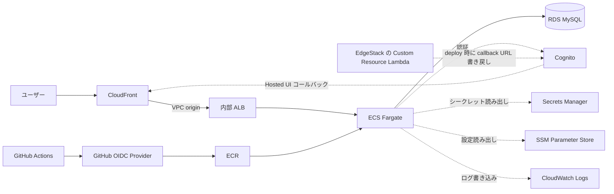
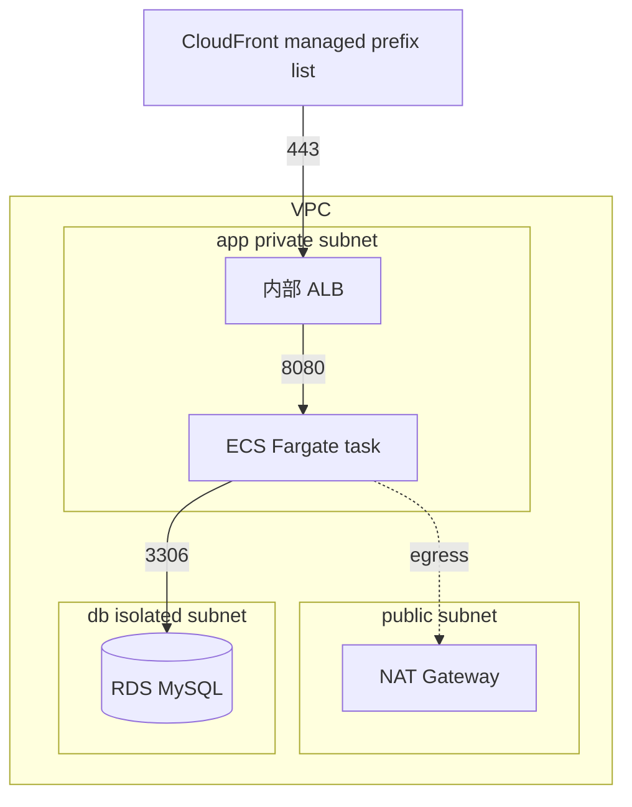
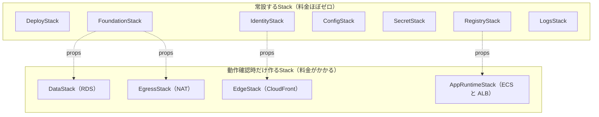
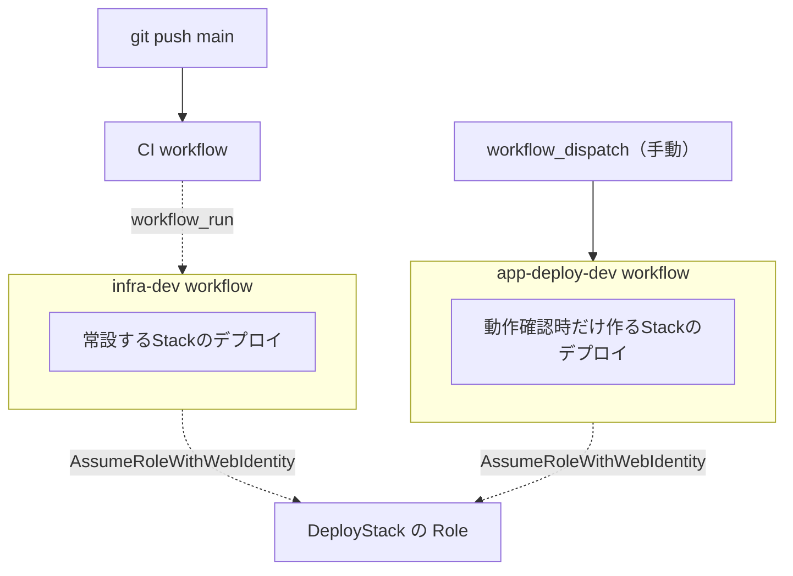
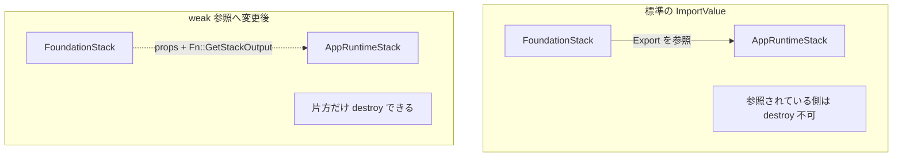
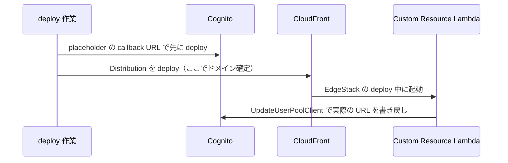
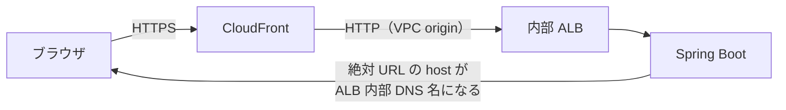
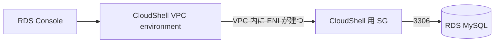

## いまWebサーバー構成をゼロから組んだ理由

こんにちは。岩波と申します。

新卒で入社して6年目になりますが、自分でWebサーバー構成を組んだことがありませんでした。

最初の4年半は、[ECS Fargate](https://docs.aws.amazon.com/AmazonECS/latest/developerguide/AWS_Fargate.html)上のSpring Bootアプリや、Lambda、Step Functions、SQSを使ったワークロードを設計・実装してきました。

その後、部署を異動し、2年ほどAWS AmplifyでWebサービスを扱うようになりました。主にCognito、AppSync、Lambda、DynamoDBを組み合わせています。

最近、Amplifyのようなサーバーレスが使われる現在も、業界ではWebサーバー型が主流だと気づきました。AWSの資格試験でも、サーバー型の構成を多く見かけます。

一方、自分が触ってきたのはアプリ層とAWSマネージドサービス上のワークロードだけでした。VPC、Subnet、Security Group、ALB、RDSは、別チームが用意したものを使っていました。

そこで、さすがにAWSの主要技術を触っていないのはまずいと感じ、自分用にWebサーバー構成を一度ゼロから組むことにしました。

VPCを3層に分け、Security Groupのingressを設定し、CloudFrontからALB、ECS、RDSまで通信できるようにするところまで、自分で書きました。AmplifyやAWSマネージドサービス、別チームに任せていた範囲も、自分で組み立てられるようになりました。

## 組んだもの

申請、資産、会社、部署、ユーザーを管理するマルチテナント業務管理WebアプリのMVPを、Spring BootとThymeleafで作りました。UIは適当です。データはもちろんダミーです。

主な機能は次のとおりです。

- マルチテナント分離（会社境界、`company_id`で他社データの参照と更新を遮断）
- CognitoのApp Client分離（運営側用と企業テナント側用）
- ロール認可（運営側のWorkOps管理者、企業テナント側の管理者・編集者・閲覧者）
- 申請管理（下書き、提出、承認、却下、差戻し）
- 資産管理と会社別マスタ管理

ここからは、このアプリを動かすAWSのWebサーバー構成と、組む途中でハマったことを書きます。

## リクエスト経路で見る全体構成

ユーザーのリクエストは、CloudFront → 内部ALB → ECS Fargate → RDS MySQLの順に進みます。

認証や設定、ログ、デプロイには、[Cognito](https://docs.aws.amazon.com/cognito/latest/developerguide/what-is-amazon-cognito.html)、[Secrets Manager](https://docs.aws.amazon.com/secretsmanager/latest/userguide/intro.html)、[SSM Parameter Store](https://docs.aws.amazon.com/systems-manager/latest/userguide/systems-manager-parameter-store.html)、[CloudWatch Logs](https://docs.aws.amazon.com/AmazonCloudWatch/latest/logs/WhatIsCloudWatchLogs.html)、[ECR](https://docs.aws.amazon.com/AmazonECR/latest/userguide/what-is-ecr.html)とGitHub Actionsを使っています。

CloudFrontの後ろにネットワーク、コンテナ、リレーショナルデータベースを配置した構成です。特殊な要素はありませんが、自分でゼロから組んだのは今回が初めてです。

## CloudFrontからRDSまで、リクエスト経路を辿る

この章では、ユーザーのリクエストがCloudFrontからRDSまで届く経路を順に追います。

CloudFrontを入口に置いた理由は、後の章で説明します。

ユーザーのブラウザからCloudFrontまではHTTPSです。CloudFrontから内部ALB、内部ALBからECSタスクまではHTTPで通信します。

[CloudFront](https://docs.aws.amazon.com/AmazonCloudFront/latest/DeveloperGuide/Introduction.html)ではキャッシュを無効にし、[origin request policy](https://docs.aws.amazon.com/AmazonCloudFront/latest/DeveloperGuide/controlling-origin-requests.html)に`ALL_VIEWER_EXCEPT_HOST_HEADER`を選んでいます。

origin request policyは、CloudFrontが受け取ったリクエストのうち、どのヘッダやクエリをオリジンへ引き渡すかを決める設定です。

以降、subnetやSGへの内向きの通信許可をingress、外向きの通信をegressと書きます。

VPCを3層のsubnetに分けています。

- public subnet：NAT Gatewayを置き、app private subnetからECRのイメージ取得やCloudWatch Logsへのログ送信に使うegressを通す
- app private subnet：ECS Fargateタスクと内部ALB
- db isolated subnet：RDS MySQL

Security Groupのingressは、CloudFrontのmanaged prefix listからALB、ALBからECSタスク、ECSタスクからRDSへの通信を順に許可しています。

[managed prefix list](https://docs.aws.amazon.com/vpc/latest/userguide/working-with-aws-managed-prefix-lists.html)は、CloudFrontの送信元IPレンジをAWSが管理・更新するリストです。SGの許可元としてそのまま指定できます。

CloudFrontからALBへの通信にもingressの許可が必要だとは、それまで一度も意識していませんでした。そのため、ALBのSGのインバウンドルールに[CloudFrontのmanaged prefix list](https://docs.aws.amazon.com/AmazonCloudFront/latest/DeveloperGuide/LocationsOfEdgeServers.html)を設定するところで一度つまずきました。

最初はALBのインバウンドルールを設定せずにCloudFrontからリクエストを送ったところ、504が返ってきました。CDKのlookupで`com.amazonaws.global.cloudfront.origin-facing`という名前からprefix list IDを取得し、インバウンドルールに設定すると通信できました。IDを`pl-...`で固定する形にはしていません。

ECSタスクのコンテナイメージはECRから取得します。

ECSタスクが必要とする設定値は、性質ごとに置き場所を分けました。`SPRING_PROFILES_ACTIVE`とJDBC URLはSSM Parameter Storeに置いています。DBのユーザー名とパスワードは、RDSが自動生成したSecrets Managerのシークレットから読み込みます。CognitoのURLとClient IDは、CDK上で環境変数として直接渡しています。

個人で動かす検証環境なので、サイズは最小にしました。

- RDSは`db.t4g.micro`
- ECSタスクは0.5 vCPU / 1 GB
- ECRのイメージは2世代まで保持
- CloudWatch Logsのログは7日間保持

これで開発期間2週間のあいだAWS料金は合計5ドル程度に収まりました。

## CDK Stackを、常設するものと動作確認時だけ作るものに分ける

5ドルで済んだのは、CDK Stackを常設するものと、動作確認時だけ作るものに最初から分けたからです。

アプリを触らない時間帯は、料金がかかるリソースだけを`destroy`で削除できるようにしたかったので、それを基準にStackを分けました。

常設するStackには、VPC、IAMのOIDC、SSM、Secrets Manager、ECR、CloudWatch Logs、Cognitoを置いています。

これらは存在しているだけでは料金がほぼかかりません。Secrets Managerのシークレット数やECRのイメージ容量に応じた料金は多少かかりますが、ほぼ無視できる額です。

これらを残しておくと、動作確認を繰り返す際の時間が短くなります。毎回作り直すとOIDC ProviderやCognito User Poolのsubが変わり、設定が合わなくなるため、常設するStackに置きました。

subはCognitoがユーザーごとに発行する不変のIDです。User Poolを作り直すと、同じユーザーでも別の値になります。

動作確認時だけ作るStackには、RDS、NAT、CloudFront、ECS、ALBを置いています。

動作確認したいときだけデプロイして、確認が終わったら`destroy`する運用にしています。

デプロイするときは、`app-deploy-dev`ワークフローで`confirm_runtime_deploy`をtrueにして、手動で起動します。ワークフローはDataStack、EgressStack、EdgeStack、AppRuntimeStackを順にデプロイします。その後、ECSサービスが安定するのを待ち、CloudFront経由で`/actuator/health`が200を返すか確認します。確認は最大10回までリトライします。

削除するときは、手元から逆順に`destroy`を実行します。

RDSのDataStackを動作確認時だけ作るかは、最初は迷いました。データを保存するRDSは残したくなりますが、常設すると毎月の料金がかかり続けます。WorkOpsのAWS開発環境では、FlywayのマイグレーションV1〜V8と`db/seed/aws-dev`のseedで毎回ゼロから再構築する設計にしました。動作確認のためのDBと割り切り、確認データの永続化は求めていません。

[Flyway](https://documentation.red-gate.com/fd)は、SQLファイルに版番号を付け、どこまで適用済みかをDB側に記録するマイグレーションツールです。seedは、動作確認用の初期データを投入するSQLを指しています。

`db/seed/aws-dev`の`V6__insert_users.sql`では、`cognito_sub`をNULLで初期化します。実際のCognito連携時に、WorkOpsの管理機能から`AdminCreateUser`を使って書き戻します。これでDataStackも`destroy`の対象にでき、常設するStackの月額をほぼゼロに保てています。

CDKのエントリーポイントは単一の`bin/cdk.ts`で、すべてのStackを定義しています。GitHub Actionsのワークフローでデプロイ対象のStackを明示し、常設するものと動作確認時だけ作るものを分けています。

- `infra-dev`ワークフロー：CI後に自動でFoundationStack、SecretStack、ConfigStack、IdentityStack、RegistryStack、LogsStackをデプロイ
- `app-deploy-dev`ワークフロー：手動でDataStack、EgressStack、EdgeStack、AppRuntimeStackをデプロイ
- GitHub Actions OIDCのRoleを持つDeployStackだけは最初の1回、手元からデプロイ

[OIDC連携](https://docs.github.com/actions/security-for-github-actions/security-hardening-your-deployments/configuring-openid-connect-in-amazon-web-services)は、GitHub ActionsにAWSのアクセスキーを持たせず、ワークフローの実行時だけ一時的な認証情報を受け取らせる仕組みです。

ワークフローはAssumeRoleWithWebIdentityでDeployStackのRoleを引き受けてからデプロイします。

SG本体はFoundationStackに置き、ingressのルールは、その通信を必要とするStackで定義しました。CloudFront prefix listからALBのSGへのHTTP 80の許可はEdgeStackで設定します。ALBのSGからECSタスクのSGへの8080の許可は、AppRuntimeStackの`CfnSecurityGroupIngress`で設定します。ECSタスクのSGからDBのSGへの3306の許可はDataStackで設定します。

通信を必要とするStackにルールを定義したことで、そのStackを`destroy`したときにルールも削除されます。常設するStackのSGに、動作確認時だけ使う通信のインバウンドルールが残らずに済みます。

Stackを分けたことで、次の2つの問題にもつまずきました。

### Custom Resource Providerが暗黙に作るLogGroupが残る

CDKで[Custom Resource](https://docs.aws.amazon.com/cdk/api/v2/docs/aws-cdk-lib.custom_resources-readme.html)を書くと、内部でLambda Providerが動き、そのLambdaがCloudWatch LogsにLogGroupを作ります。

このLogGroupはCustom ResourceのStackに紐づいて作られるはずなのですが、Stackを`destroy`してもLogGroupが消えませんでした。

`RemovalPolicy.DESTROY`を設定しているつもりだったので、削除されると思っていました。

調べると、Providerが暗黙に作るLogGroupには、CDKの`RemovalPolicy`が適用されていないようでした。

LogGroupをProviderと同じStack内で明示的に作り、[Providerに`logGroup`で渡す形](https://docs.aws.amazon.com/cdk/api/v2/docs/aws-cdk-lib.custom_resources.Provider.html)に直しました。これでStackの`destroy`時にLogGroupも削除されるようになり、不要なLogGroupが増えなくなりました。

LogGroupはProvider用と、Custom Resourceの実体であるLambda用の2つを別々に作り、それぞれのconstructに渡しています。

### `ImportValue`で参照されているStackを削除できない

Stack間で値を渡すと、CDKは標準では[`Fn::ImportValue`](https://docs.aws.amazon.com/AWSCloudFormation/latest/TemplateReference/intrinsic-function-reference-importvalue.html)を使います。

参照されている側のStackを削除しようとすると、「他のStackがexportを使っている」というエラーが出て`destroy`できません。

動作確認時だけ作るStackを`destroy`するたびに、このエラーでつまずきました。

`defaultCrossStackReferences: weak`を設定し、依存する値はpropsで渡すようにしました。CloudFormation側では[`Fn::GetStackOutput`](https://aws.amazon.com/blogs/devops/simplify-cross-account-and-cross-region-stack-output-references-with-aws-cloudformation-and-cdks-new-fngetstackoutput/)で読む形に変えたところ、削除できるようになりました。

ImportValueを使わなくなったことで、参照によって`destroy`が制限される問題を解消できました。

## 個人検証環境で省いた構成

個人検証環境では、本番なら入れる構成要素も省きました。これも、開発期間2週間でAWS料金が合計5ドル程度に収まった理由です。

省いた項目と、本番で使う場合の想定をまとめます。

**RDSのMulti-AZ**は使っていません。DataStackのMySQLはSingle-AZ、`db.t4g.micro`、20 GB gp2です。検証データを毎回Flywayで作り直す前提なので、冗長化は省きました。本番ではMulti-AZにするか、Aurora Serverless v2に置き換えます。

**独自ドメインとACM証明書、Route 53**も使っていません。CloudFrontのデフォルトドメインがそのままHTTPSの入口になるので、ドメイン取得、DNS設定、ACM証明書の発行を省きました。

**WAF**はCloudFrontの前段に設定していません。攻撃面を持たない検証環境なので省きました。独自ドメイン化とあわせて、AWS WAFをマネージドルールで紐付けます。

**NAT Gatewayの冗長化**も省きました。EgressStackのNATは1つだけで、public subnet[0]に置いています。app private subnetは2 AZにあるため、片方のAZがダウンするとECRからのイメージ取得が失敗します。本格運用では各AZに1つずつ置きます。

**ALBのHTTPSリスナー**は使っていません。内部ALBのリスナーはHTTP 80だけです。CloudFront → 内部ALBのVPC originがHTTPなので、ALBに証明書を設定していません。

**ECSサービスのAuto Scaling**は設定せず、desiredCountを1に固定しています。検証中に同時アクセスが増える状況がないので、1タスクで十分です。

**CloudWatch LogsとECRの保持期間**は短くしています。ログは7日間、ECRのタグ付きイメージは2世代まで保持し、タグなしイメージは1日で削除しています。

構成の省略とStackの分離を組み合わせたことで、常設するリソースにはほぼ料金がかからなくなりました。

常設するIAM Role、Cognito User Pool、SSM Parameter Store、Secrets Manager、ECR、CloudWatch LogGroupは、いずれもアイドル時の課金がほぼゼロです。

シークレットの数が少なく、ECRのイメージ容量も小さいうえ、検証中のCognitoのMAUもゼロに近いため、常設しても毎月の料金はほぼ無視できる額です。

2週間でかかった5ドル程度は、動作確認用のStackをデプロイしていた時間に、NAT Gateway、RDS、ECSタスク、ALBを使った分です。

## CloudFrontを入口に置いた理由

入口には、CDNであるCloudFrontを置きました。業界一般のWebサーバー構成では、CloudFrontを入口に置くのが標準的な構成です。

検証構成では配信の負荷分散やエッジキャッシュは使っていません。それでも入口を標準的な構成にしておくと、WAFの追加、Origin Shieldの有効化、別のオリジンの追加、Lambda@Edgeの導入といった拡張を選べます。

CloudFrontのデフォルトドメインは、そのままHTTPSの入口になります。`*.cloudfront.net`という形式で、ACM証明書を別途用意する必要はありません。

独自ドメインを取得しない個人検証環境では、このデフォルトドメインを入口にしました。ACM証明書の発行、Route 53の設定、ALBのHTTPSリスナーと証明書の差し替えを省けました。

CloudFrontの[VPC origin](https://docs.aws.amazon.com/AmazonCloudFront/latest/DeveloperGuide/private-content-vpc-origins.html)を使うと、private subnetの内部ALBに直接到達できます。そのため、ALBをapp private subnetに置いたまま、外からのリクエストを受けられます。

ALBのSGのインバウンドルールでは、CloudFront prefix listだけを許可しています。ALBを公開する構成と比べて、インターネットに直接さらさずに済みます。

CloudFrontを入口にしたことで、Cognito Hosted UIの戻り先の設定には2か所でつまずきました。

[Hosted UI](https://docs.aws.amazon.com/cognito/latest/developerguide/cognito-user-pools-managed-login.html)は、Cognitoが用意するログイン画面を使える機能です。ログイン後はApp Clientに登録したcallback URLへ戻ります。

### Cognito callback URLとCloudFrontドメインの循環依存

CognitoのApp Clientのcallback URLには、CloudFrontのドメインが必要です。一方、CloudFront側のデプロイにはCognitoのHosted UI URLが必要で、循環依存になりました。

CloudFrontのドメインは、Distributionをデプロイした時点で確定します。それまではCognitoのcallback URLに設定する文字列が分かりません。

最初は`https://example.com/`のような仮のcallback URLでCognitoをデプロイします。その後、CloudFrontのデプロイが終わったら、EdgeStackのCustom Resourceで実際のCloudFrontドメインを書き戻します。この2段階に分けて解決しました。

書き戻す側はEdgeStack内のCustom Resource Lambdaで、`UpdateUserPoolClient` APIを呼び出します。

運営側用と企業テナント側用の2つのApp Clientに対して、それぞれ`https://<distribution-domain>/login/oauth2/code/platform`、`/login/oauth2/code/tenant`のURLを組み立てて書き込んでいます。運営側用は`/platform`、企業テナント側用は`/tenant`で受ける形です。

Custom ResourceはCreateとUpdateのときだけURLを書き戻し、Deleteのときは何もしません。

EdgeStackを`destroy`するときにcallback URLを仮の値へ戻してしまうと、次にEdgeStackを作り直すまでCognitoのHosted UIが使えない状態で残ります。そのため、Deleteでは最後に書き込んだURLをそのまま残す形にしました。

### Cognitoから戻るとURLがALBの内部DNS名になる

Cognito Hosted UIでログインしたあと、リダイレクト先のページから次のページに移ろうとすると、絶対URLのホスト名がALBの内部DNS名になっていて、ブラウザから到達できませんでした。

Spring SecurityがOAuth2ログイン後のリダイレクトで返す絶対URLを、ALBの内部DNS名から組み立てていたことが原因でした。リクエストのHostヘッダは使われていませんでした。

ブラウザからCloudFrontまではHTTPS、CloudFrontから内部ALBのVPC originまではHTTPのため、`X-Forwarded-Proto`と`X-Forwarded-Host`の扱いが関係します。

Spring Boot側で`server.tomcat.use-relative-redirects=true`を設定し、相対URLを返すようにしたら解決しました。絶対URLは返さない形です。

相対URLならホスト名を組み立てる必要がないため、Hostヘッダの違いは結果に影響しません。

## その他、組む途中でハマったこと

### private subnetにいるRDSの中身をどう見るか

RDSはdb isolated subnetに置いているため、手元のMySQLクライアントからは直接接続できません。EC2の踏み台やSSMのポートフォワーディングなどを調べ、今回はAWS ConsoleのRDS画面にある「[CloudShell VPC environment](https://docs.aws.amazon.com/cloudshell/latest/userguide/creating-vpc-environment.html)で接続」を使うことにしました。

RDS ConsoleからCloudShell VPC environmentを起動すると、VPC内にCloudShell用のENIが作られます。`mysql`クライアントが入った環境から接続し、`USE workops;`まで実行できました。ENIは仮想のネットワークインターフェースです。これを通じて、CloudShellからVPC内のリソースへ到達できます。

DataStackにはCloudShell VPC environment専用のSGを用意し、自身を参照するルールでMySQL 3306の通信を許可したうえで、RDSに割り当てています。確認が終わったらCloudShell VPC environmentは削除します。

## これから足したい部分

今後は、運用面で次の2つに取り組みたいと考えています。

- 本番相当の運用監視（CloudWatch Alarmの整備、SNS通知）
- バックアップとリストア手順の検証

## ソースコード

@[card](https://github.com/kyiwanami/workops)

## 追記

このWebサーバー構成の上に、AWSネイティブのCI/CDパイプラインを組んだ話も書きました。

@[card](https://zenn.dev/kyiwanami/articles/aws-cdk-pipelines-cicd)

## おわりに

これまで触ってこなかった範囲を自分で書いてみたことで、Webサーバー構成を自分で組み立てられるようになりました。

ところで、今回の開発はAIをフル活用しました。コーディングはすべてコーディングエージェントに任せていて、自分では1行も書いていません。

要件、基本設計、ADR、実装計画は、Notion上でNotion AIと相談して固めました。確定した内容をコーディングエージェントに渡し、実装を任せる進め方です。

コードと設定の最終レビューと採否の判断は、自分で行うようにしました。

この開発手法そのものについては、別記事で改めて書こうと思います。
